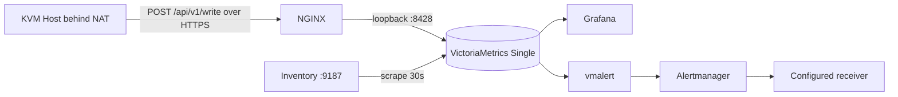

# Central monitoring: deployment and operations

[繁體中文](central-monitoring.zh-TW.md) · [Monitoring architecture](monitoring.md)

Deploy Central once, choose one remote writer mode per KVM Host, then register the expected Host. For the mode comparison and complete architecture see [Monitoring](monitoring.md#choose-a-mode). For local-only operation use [Local monitoring](monitoring-stack.md).



| Listener | Stock address | Access |
|---|---|---|
| VM exporter (Host) | `127.0.0.1:9179` | Local scraper only |
| node_exporter (remote modes) | `127.0.0.1:9100` | Local scraper only |
| vmagent (Agent) | `127.0.0.1:8429` | Local diagnostics |
| Central TSDB / Grafana | `127.0.0.1:8428` / `127.0.0.1:3000` | Operators; trusted proxies only |
| Inventory / vmalert / Alertmanager | Docker internal `9187` / `8880` / `9093` | Internal services |
| Write ingress | Operator-configured HTTPS (typically 443) | Host writer identities |
| Panel query ingress (optional) | Separate private HTTPS listener | Trusted Panel only |

## Deployment sequence

1. Start Central and check its local health.
2. Choose **one** ingress type for each writer endpoint (managed or legacy); install TLS and credentials. For managed writers choose a Host UUID and register inventory **before** activation.
3. Start Agent or Hybrid on the Host; verify identity and raw metrics centrally.
4. Register expected hosts not already registered; configure notification receiver and test delivery.
5. Optionally configure the private Panel integration; do not expose Central Grafana to customers.

## 1. Install Central

Requirements: Linux, Docker Engine, Docker Compose v2, Python 3; no libvirt or VM management program is required.

```bash
sudo ./tools/setup-central-monitoring.sh up
sudo ./tools/setup-central-monitoring.sh credentials
```

The central stack runs VictoriaMetrics Single, Grafana, vmalert, Alertmanager and the inventory exporter. Default bind addresses: `127.0.0.1:8428` (VictoriaMetrics API) and `127.0.0.1:3000` (Grafana). Neither interface is public. In particular **VictoriaMetrics has no built-in authentication in this deployment**; NEVER expose its port to the internet. The named Docker volumes survive `down`, reboot, and upgrades. Storage retention defaults to 30 days:

```bash
sudo env GRAFANA_PORT=3100 VM_PORT=8430 VM_RETENTION=60d \
    ./tools/setup-central-monitoring.sh up
```

Optional: `render DIRECTORY` previews the configuration without Docker. First-run environment settings are saved in `.env`; subsequent runs use saved settings. Subsequent `up` calls do not overwrite existing `.env`, dashboard/rules files or the hashed-credentials file. To upgrade, edit the pinned image tags in `/etc/kvm-vm/central/compose.yaml`, then run `update` after taking a backup.

## 2. Configure authenticated HTTPS write ingress

| Option | Credentials | Host binding |
|---|---|---|
| Managed (opt-in) | `writers stage/activate/rotate/revoke` | Intended immutable Host UUID binding; verify pinned receiver in the live drill |
| Legacy (compatible) | `enroll` + manual htpasswd synchronization | Sender authentication only |

For a new managed deployment follow [Writer lifecycle](monitoring-security-reliability.md#managed-writer-lifecycle-opt-in), including UUID registration and real backend acceptance. The following commands describe the legacy path; do not combine the two authentication files.

### Legacy ingress

Use a dedicated DNS name, e.g. `metrics.example.com`, resolving to the central machine. Set up a valid TLS certificate using your existing NGINX/certbot or another HTTPS reverse proxy. Inside that HTTPS virtual host, use the location blocks from:

`tools/monitoring/central/nginx-remote-write.example.conf`

The proxy accepts **only POST `/api/v1/write`**, requires Basic Auth with a **per-host credential**, and forwards to `127.0.0.1:8428`. Block all other routes from this public virtual host. Restrict ingress by source firewall rules where feasible and rate-limit requests as needed. If `VM_PORT` is customized, update the example NGINX `proxy_pass` port accordingly. Do not disable TLS verification on the agents.

Enroll a unique username for each host (use the host UUID if convenient):

```bash
sudo ./tools/setup-central-monitoring.sh enroll kvm-tpe-01
# Shows a randomly generated password ONCE and saves only a bcrypt hash.
```

The `enroll` command uses a short-lived `httpd:2.4-alpine` Docker container to run `htpasswd -B` with password supplied on stdin. On the central host, copy `/etc/kvm-vm/central/htpasswd` to `/etc/nginx/kvm-vm/htpasswd`, ensuring the NGINX worker can read it, and reload NGINX. Re-copy the file each time you enroll, rotate or revoke a credential. **Revocation:** remove the matching line from the central htpasswd, deploy it to NGINX, and reload NGINX; a disabled host's existing queued data can no longer be uploaded. Do not expose `/metrics` from the KVM hosts publicly.

Grafana should be used by internal administrators only. Access over SSH port-forwarding (`ssh -L 3000:127.0.0.1:3000 ...`) or an authenticated, TLS-protected private admin network. The provisioning does **not** implement per-customer isolation.

## 3. Deploy Agent or Hybrid on each Host

Each KVM host needs Docker Compose v2, systemd, Python 3, virsh and a working libvirt service. Create a root-readable password file on the host using the credential from the selected Central ingress:

```bash
sudo install -d -m 0700 /etc/kvm-vm
sudo sh -c 'umask 077; cat > /etc/kvm-vm/central-password'
# Type/paste password and press Ctrl-D. Avoid putting it in shell history.

sudo env \
  KVM_VM_REMOTE_WRITE_URL=https://metrics.example.com/api/v1/write \
  KVM_VM_REMOTE_USERNAME=WRITER_USERNAME \
  KVM_VM_REMOTE_PASSWORD_FILE=/etc/kvm-vm/central-password \
  KVM_VM_MONITOR_HOST=kvm-tpe-01 \
  KVM_VM_MONITOR_SITE=taipei \
  ./tools/setup-monitoring.sh up --mode agent
```

Replace `WRITER_USERNAME` with the actual credential name (`kvm-tpe-01` in the legacy example). For managed ingress set `KVM_VM_MONITOR_HOST_ID` to the UUID registered on Central before the first deployment, and use the staged/activated username as `WRITER_USERNAME`. For legacy ingress the UUID may be generated on the first deployment. The generated `remote.json` stores a **random, stable `host_id` UUID**, a human-friendly host, and site. This metadata labels scraped VM and Collector metrics, differentiating identical VM names on different KVM hosts. Never regenerate the ID on restart or mode transition. The host-level `remote-password` is stored in an owner-only directory (`0700`); the file is `0644` *within* that private directory so a non-root collector process inside its bind-mounted Docker container can read it. It is not inserted in Compose `.env` or printed as command-line arguments.

`vmagent` uses a Docker named volume to persist its queue, capped by default at **2 GiB per destination**. If the destination stays offline and the queue is full, oldest buffered samples are lost. This is a best-effort buffer, **not an indefinite archive**. Metrics scrape interval is 15s; exporter samples locally every 5s. Agent self-metrics are available at `http://127.0.0.1:8429/metrics`.

To inspect or stop the Agent (preserves queue):

```bash
sudo ./tools/setup-monitoring.sh status --mode agent
sudo ./tools/setup-monitoring.sh logs --mode agent
sudo ./tools/setup-monitoring.sh update --mode agent
sudo ./tools/setup-monitoring.sh down --mode agent
```

### Hybrid mode

On the KVM host, set the same `KVM_VM_REMOTE_*` environment variables as above and run:

```bash
sudo ./tools/setup-monitoring.sh up --mode hybrid
```

This boots the **existing local** Prometheus/Grafana and overlays its Prometheus config with `remote_write`. It preserves the existing TSDB and Grafana volumes. Hybrid relies on Prometheus WAL buffering, whose retention/compaction can discard unsent data during extended outages (roughly two hours is a planning heuristic, not a guarantee); choose `agent` with vmagent's disk queue for longer intermittent outages. Hybrid does not forward the full local Grafana configuration, dashboards or alerts — only sampled metrics. The generated Hybrid scrape config sets `external_labels` for outbound identity. Stock remote VM and Host samples carry `host_id`, `host`, and `site`; do not assume every custom series or incoming label is trusted.

**Important:** The generated `prometheus-hybrid.yml` provides the standard exporter scrape job. If you have customized the original `prometheus.yml` with more scrape jobs, review and merge them into the hybrid config after the first deployment. Subsequent `up` runs preserve customized scrape files. A deliberate `KVM_VM_REMOTE_RECONFIGURE=1` overwrites generated configurations; back up custom jobs first. The original file is never overwritten. Do not run Agent and Hybrid concurrently for the same Host.

## 4. Register expected hosts and verify identity

The central stack runs a private, read-only **inventory exporter** (Docker internal port 9187; no published port), which reads `/etc/kvm-vm/central/inventory/hosts.json`. VictoriaMetrics Single scrapes it every 30 seconds and creates `kvm_vm_host_expected{host_id,host,site} 1` for enabled hosts. `KvmVmHostOffline` checks this persistent expected-host series against remote VM collector reports seen during the last five minutes, with an additional five-minute alert `for` duration. It therefore detects **complete host disappearance** (unlike `up == 0` on a remote writer). A missing collector is not necessarily a powered-off host: network failure, exporter failure and remote-write failure may also cause it.

**Important:** HTTP ingestion enrollment and expected-host inventory are intentionally separate. For legacy ingress, after installing Agent/Hybrid, retrieve the UUID on the **Host** with [`kvm-vm identity --json`](integration/identity.md) and register it on the **Central Server**:

```bash
sudo ./tools/setup-central-monitoring.sh inventory add \
  eb90c4d9-7b0e-4f4f-a4bb-9490124c85ae kvm-tpe-01 taipei
sudo ./tools/setup-central-monitoring.sh inventory list
# During a planned maintenance window:
sudo ./tools/setup-central-monitoring.sh inventory disable eb90c4d9-7b0e-4f4f-a4bb-9490124c85ae
# Re-enable after maintenance:
sudo ./tools/setup-central-monitoring.sh inventory enable eb90c4d9-7b0e-4f4f-a4bb-9490124c85ae
# Permanent decommission (does NOT revoke HTTP credentials):
sudo ./tools/setup-central-monitoring.sh inventory remove eb90c4d9-7b0e-4f4f-a4bb-9490124c85ae
```

For managed ingress, perform the same registration before `writers activate` using the preselected UUID. Compare against the Host identity after deployment. Register only hosts that **should** report, using exactly the same `host_id` as the Remote Writer. Otherwise a false-offline alarm is expected. Stale data may remain queryable after decommission until retention expires. Disabling inventory prevents offline alarms, but **does not revoke authentication**; revoke the NGINX Basic Auth credential separately when retiring a Host. Registry data survives stack upgrades, `down`, and restarts.

On a newly enrolled host that has not yet uploaded metrics, offline alerts start after the configured window. The Central `KvmVmInventoryScrapeFailed` alert catches an inventory exporter failure; `KvmVmHostOffline` cannot be evaluated reliably if the central inventory service is not healthy.

The optional legacy Host `--tenant` / `set-tenant` metadata is for auditing only. Before using these options on an older deployment, perform the reviewed template sync below; the CLI checks that the deployed inventory exporter matches the current template. Host metadata does not propagate to VM ownership. For independent operator VM history use [Ownership registry](monitoring-registry.md); with an existing Panel, use its authoritative database instead.

### Host metrics

Agent and Hybrid include a localhost-only **node_exporter** container (pinned `v1.12.1`) bound to `127.0.0.1:9100` on the KVM host. The containers use Linux host networking, PID namespace and a read-only `/:/host` mount so that they monitor the **host**, not just the Docker container. `node_exporter` provides host CPU, memory, filesystem and network metrics without entering any VM.

Agent `vmagent-scrape.yml` or Hybrid `prometheus-hybrid.yml` collects node_exporter at 15-second intervals, with the same host identity as VM metrics. The **KVM Hosts Overview** central Dashboard correlates expected/online hosts with Host CPU, available RAM, storage and network activity. Some virtual filesystems are excluded from disk alerts. All node_exporter connections remain local to the KVM host, with no new WAN port.

If port 9100 is occupied, reconcile the existing collector before deployment. Existing deployments must use a reviewed reconfiguration to adopt updated scrape/Compose templates (see upgrades below).

## 5. Dashboards, alerts and notifications

| Dashboard | Contents |
|---|---|
| KVM Fleet Overview | Expected/reporting Hosts, VM totals, Agent queue, Hybrid lag, collector sample age, Central free space |
| KVM Hosts Overview | Host CPU, memory, filesystem and network activity |
| KVM Fleet – Virtual Machines | Site/Host/VM/UUID filters, CPU, memory, disk IOPS/latency, network rates and collector status |

For exact alert names and thresholds use [rules.yml](../tools/monitoring/central/rules/rules.yml). Host disappearance and inventory scrape failure are distinct from VM collector failure; queue growth/discard, rejection, Hybrid lag/failure, delayed samples, Host memory/disk pressure and Central component/storage health also have rules. A completely disconnected Host cannot report its own queue state; use local diagnostics and an independent observer (see [Security and reliability](monitoring-security-reliability.md)). No notification is sent until an operator configures a receiver.

### Email and Webhook notifications

Alertmanager v0.34.2 (for file-backed Webhook URLs and implicit SMTP TLS configuration) starts with the `unconfigured` receiver, intentionally sending nothing until an administrator supplies a destination. Both methods keep secret material **out of the Compose environment and Alertmanager YAML** by using read-only secret-file mounts. Alertmanager config remains private to the Central Host; no public Alertmanager port is opened.

```bash
# File contains the full HTTPS webhook URL, one line, including any token.
sudo ./tools/setup-central-monitoring.sh notifications webhook /root/alert-webhook-url
# or: SMTP password in one line of a readable file (587 = STARTTLS; 465 = implicit TLS).
sudo ./tools/setup-central-monitoring.sh notifications email \
  admin@example.com smtp.example.com:587 monitor@example.com \
  monitor@example.com /root/smtp-password

# Configuration files are bind-mounted; recreate containers to pick up updates.
sudo ./tools/setup-central-monitoring.sh reload
```

No test message is sent automatically; confirm delivery using a controlled test alert before trusting the notification channel. For HTTP Webhooks, the destination must accept the [Alertmanager generic JSON webhook schema](https://prometheus.io/docs/alerting/latest/configuration/#webhook_config), not an arbitrary Slack/Discord JSON format. SMTP credentials must be provisioned by the operator. The secret file within Central is world-readable only **inside** an administrator-only (`0700`) parent directory on the host so that the non-root Alertmanager process can read its container mount. Root and Docker administrators can still read these secrets.

## 6. Mode changes and configuration persistence

To change from `agent` to `hybrid` (or the reverse), **stop the current mode first** and then start the other mode. `down` never includes `docker compose down -v`; queue, Prometheus TSDB and Grafana volumes remain intact. The `remote.json` UUID and `remote-password` file are reused. A mode marker prevents accidentally running the original local installer over a remote configuration.

```bash
sudo ./tools/setup-monitoring.sh down --mode agent
sudo ./tools/setup-monitoring.sh up --mode hybrid
```

To return to local-only, stop the remote mode, then run `sudo ./tools/setup-monitoring.sh up`. The localhost VM exporter may be reused if it is already running. Note: mode switching does not transfer samples between vmagent's queue and Prometheus's WAL. Wait for the queue to drain before cutting over if continuity matters.

Saved settings: `/etc/kvm-vm/monitoring/remote.json`, `remote.env`, `remote-password`, `vmagent-scrape.yml`, `prometheus-hybrid.yml`, and per-mode Compose files. Saved identity and secret files are not overwritten on subsequent runs. To **change** a remote endpoint or username, explicitly edit `remote.json`, review the change, and re-run the mode's `up` with `KVM_VM_REMOTE_RECONFIGURE=1` (overwrites generated scrape files). For password rotation stop the writer and follow the [coordinated rotation procedure](monitoring-security-reliability.md#rotate-without-changing-destination-or-queue); use `replace-password` rather than overwriting a live bind mount. Do not send a queued batch with invalid credentials. Avoid changing the vmagent remote URL unnecessarily because it can change how on-disk queues are associated with endpoints.

If interrupted deployment leaves `.mode.pending`, rerun `up` or `down` in the recorded mode; do not manually remove the marker.

## 7. Upgrade existing deployments

Initial `up` and subsequent restarts never overwrite customized template files. To adopt the new Inventory exporter, scrape configuration, rules and Host dashboard, explicitly run:

```bash
sudo ./tools/setup-central-monitoring.sh sync-templates
sudo ./tools/setup-central-monitoring.sh reload
```

`sync-templates` creates a dated backup under `/etc/kvm-vm/central/backups/`, then replaces the bundled **Compose, inventory exporter, scrape, all three Dashboards and alerting rules**. It **preserves** inventory `hosts.json`, `.env`, Grafana history, VictoriaMetrics volumes, authentication credentials, and the customized Alertmanager receiver. Review modified Compose/alerting rules before running it. `reload` uses Docker Compose `up -d --force-recreate`; containers briefly restart, but named volumes are kept. Running `up` alone might not reload an atomically replaced bind-mounted file.

For Host updates, check the queue, stop the current mode, and back up custom scrape/Compose files including private CA mounts. Render the new templates without starting services, review the differences and merge necessary custom jobs and trust configuration, then start without the reconfigure flag. For example, Agent with the default directory:

```sh
sudo ./tools/setup-monitoring.sh down --mode agent
sudo env KVM_VM_REMOTE_RECONFIGURE=1 ./tools/setup-monitoring.sh render /etc/kvm-vm/monitoring --mode agent
# Review and merge required custom settings from the backup before starting.
sudo ./tools/setup-monitoring.sh up --mode agent
```

Use `--mode hybrid` for Hybrid and the actual saved directory if customized. This preserves identity, secret files and named volumes but replaces generated configurations. Upgrade the installed CLI and restart the exporter to activate new metrics. Local-only dashboard upgrades are described in [Local monitoring](monitoring-stack.md).

## 8. Verify and operate

```sh
# On the Host
sudo kvm-vm identity --json
curl -fsS http://127.0.0.1:9179/healthz
sudo ./tools/setup-monitoring.sh diagnostics --mode agent  # or hybrid
# On Central
curl -fsS http://127.0.0.1:8428/health
sudo ./tools/setup-central-monitoring.sh status
sudo ./tools/setup-central-monitoring.sh logs
```

Using the internal query API or admin Grafana, verify that `kvm_vm_host_expected` and `kvm_vm_collector_success` carry the same Host UUID, `kvm_vm_domain_vcpus` has the correct `vm_id`, node_exporter samples are present, and `up{job="kvm-vm-inventory"} == 1`. Check actual new sample timestamps. Test the offline and notification paths on a disposable lab; do not deliberately disconnect a production host for acceptance without a maintenance plan. See [Monitoring acceptance](monitoring-acceptance.md) and [Security and reliability](monitoring-security-reliability.md) for longer outages, independent observation and backup/restore.

**Customer access:** Central Grafana and raw TSDB remain operator-only (`customer-readiness` exits 2). [External Panel integration](integration/monitoring-api.md) is a separate trusted-service option with its own acceptance; do not hand its credentials or arbitrary query access to customers. [ADR 0006](adr/0006-central-monitoring-tenant-security-boundary.md) governs native storage isolation; [ADR 0007](adr/0007-external-panel-monitoring.md) governs the Panel path.
