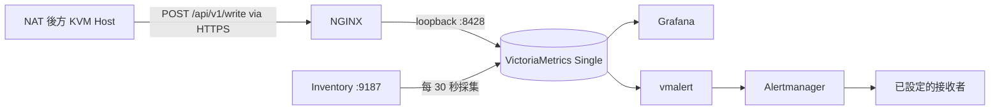

# 中央監控：部署與操作

[English](central-monitoring.md) · [監控架構](monitoring.zh-TW.md)

中央部署一次，每台 KVM Host 選擇一種遠端 Writer，再登錄預期在線主機。完整架構與模式比較請見[監控導覽](monitoring.zh-TW.md)，單機使用請見[本機監控](monitoring-stack.zh-TW.md)。



| 介面 | 預設位址 | 存取對象 |
|---|---|---|
| VM Exporter（Host） | `127.0.0.1:9179` | 本機採集器 |
| node_exporter（遠端模式） | `127.0.0.1:9100` | 本機採集器 |
| vmagent（Agent） | `127.0.0.1:8429` | 本機診斷 |
| 中央 TSDB／Grafana | `127.0.0.1:8428`／`127.0.0.1:3000` | 管理員與受信任代理 |
| Inventory／vmalert／Alertmanager | Docker 內部 `9187`／`8880`／`9093` | 內部服務 |
| 寫入入口 | 自行設定 HTTPS（通常 443） | Host Writer |
| Panel 查詢入口（選用） | 獨立私有 HTTPS listener | 受信任 Panel |

## 部署順序

1. 啟動中央監控，確認本機服務。
2. 為寫入入口選擇 Managed 或 Legacy，配置 TLS 及認證。Managed 必須先選定 Host UUID 並登錄 Inventory 才能啟用。
3. 在 Host 啟動 Agent／Hybrid，核對 UUID 與中央樣本。
4. 登錄尚未登錄的預期在線 Host，設定並驗證告警通知。
5. 如需第三方 Panel，再部署私有唯讀入口與完成獨立驗收；不得公開中央 Grafana 給客戶。

## 1. 建立中央伺服器

需求：Linux + Docker Engine + Compose v2 + Python 3；不需要 libvirt。

```bash
sudo ./tools/setup-central-monitoring.sh up
sudo ./tools/setup-central-monitoring.sh credentials
```

中央提供 VictoriaMetrics、Grafana、vmalert、Alertmanager 與 Inventory Exporter。VictoriaMetrics 預設 `127.0.0.1:8428`，Grafana 預設 `127.0.0.1:3000`，**僅綁定本機**。VictoriaMetrics 在此部署未啟用內建身分驗證，絕對不可直接公開 8428 埠。資料儲存在 Docker named volumes，`down` 不會刪除。預設保留 30 天。

```bash
sudo env GRAFANA_PORT=3100 VM_PORT=8430 VM_RETENTION=60d \
  ./tools/setup-central-monitoring.sh up
```

首次設定儲存於 `.env`，後續啟動沿用已保存值。可以用 `./tools/setup-central-monitoring.sh render DIRECTORY` 離線產生設定；重複執行不覆蓋既有 `.env`、Dashboard、告警規則。升級版本前先備份並調整保存於 `/etc/kvm-vm/central/compose.yaml` 的 image tag。

## 2. 配置 HTTPS 寫入入口（必要）

| 方案 | 憑證 | Host 綁定 |
|---|---|---|
| Managed（選用） | `writers stage/activate/rotate/revoke` | 不可變 Host UUID 綁定，須實測指定儲存端的覆寫行為 |
| Legacy（相容） | `enroll` 與人工同步 htpasswd | 只驗證傳送端 |

新部署若採 Managed，依[Writer 生命週期](monitoring-security-reliability.zh-TW.md)設定，並先登錄 Host UUID。以下為 Legacy 操作，兩種認證檔不可混用。

### Legacy 入口

使用獨立的 DNS 名稱，例如 `metrics.example.com`，並用 NGINX 與有效 TLS 憑證建立 HTTPS Reverse Proxy。範例位於：

`tools/monitoring/central/nginx-remote-write.example.conf`

這個入口只允許 `POST /api/v1/write`，透過每台 Host 的獨立 Basic Auth 帳密驗證，後送到 localhost 的 VictoriaMetrics。其餘路徑返回 404，不能直接公開儲存端的其他 API。若修改 `VM_PORT`，也必須同步修改 NGINX 範例中的 `proxy_pass` 埠號。

在中央建立 Host 憑證：

```bash
sudo ./tools/setup-central-monitoring.sh enroll kvm-tpe-01
```

此指令透過短暫的 `httpd:2.4-alpine` 容器執行 `htpasswd -B`，密碼經 stdin 傳入，**僅顯示一次**，中央只保存 bcrypt hash。部署 `/etc/kvm-vm/central/htpasswd` 到 `/etc/nginx/kvm-vm/htpasswd` 並確認 NGINX worker 可讀後 reload。每次新增、撤銷或更換憑證都要同步該檔。撤銷時刪除對應使用者的 hash 並重新載入 NGINX。

Grafana 僅供內部管理員使用，建議 SSH Tunnel（`ssh -L 3000:127.0.0.1:3000 ...`）或已驗證的私有管理網路。共享中央部署不提供原生租戶隔離。

## 3. 部署各 KVM Host（Agent 或 Hybrid）

Host 需 Docker Compose v2、systemd、Python 3、virsh 與可用的 libvirt。先在 Host 安全建立密碼檔：

```bash
sudo install -d -m 0700 /etc/kvm-vm
sudo sh -c 'umask 077; cat > /etc/kvm-vm/central-password'
# 輸入選定的中央入口密碼，按 Ctrl-D 結束；勿直接寫入 Shell 歷史。

sudo env \
  KVM_VM_REMOTE_WRITE_URL=https://metrics.example.com/api/v1/write \
  KVM_VM_REMOTE_USERNAME=WRITER_USERNAME \
  KVM_VM_REMOTE_PASSWORD_FILE=/etc/kvm-vm/central-password \
  KVM_VM_MONITOR_HOST=kvm-tpe-01 \
  KVM_VM_MONITOR_SITE=taipei \
  ./tools/setup-monitoring.sh up --mode agent
```

上述 `WRITER_USERNAME` 請替換成實際帳號（Legacy 範例為 `kvm-tpe-01`）。Managed 部署需在首次啟動時設定 `KVM_VM_MONITOR_HOST_ID` 為已登錄的 UUID，`WRITER_USERNAME` 為已啟用的 Writer 帳號；Legacy 可以在首次部署時自動產生 UUID。首次安裝會保存**持久化且穩定的 `host_id` UUID**，加入 metrics `host_id`、`host`、`site` labels，避免不同 Host 的同名 VM 混淆。身份保存在 `remote.json`，切換模式不可重新產生。密碼檔存於 0700 私有目錄；檔案為 0644，供 Docker 內非 root 行程透過唯讀 bind mount 讀取。密碼不會被寫進 Compose 環境變數、metrics 或命令列參數。

vmagent 每 15 秒抓取 Exporter，佇列使用 Docker named volume，預設每個目的地上限 **2 GiB**。長期斷線且佇列滿時會丟棄最舊資料，不能視為無限期保留。Exporter 自身預設每 5 秒採樣一次。

```bash
sudo ./tools/setup-monitoring.sh status --mode agent
sudo ./tools/setup-monitoring.sh logs --mode agent
sudo ./tools/setup-monitoring.sh update --mode agent
sudo ./tools/setup-monitoring.sh down --mode agent
```

### Hybrid 模式

使用與 Agent 相同的 `KVM_VM_REMOTE_*` 設定：

```bash
sudo ./tools/setup-monitoring.sh up --mode hybrid
```

本機 Prometheus／Grafana 與歷史資料保留，Prometheus 新增 `remote_write` 傳送至中央，不額外啟動 vmagent。Hybrid 的 Prometheus WAL 受保留／壓縮機制限制，長時間中斷可能失去未送資料（約兩小時僅為規劃參考，非保證）；若跨機房斷線可能持續更久，建議 Agent。

原本的 `prometheus.yml` 不會被覆蓋；Hybrid 改用獨立產生的 `prometheus-hybrid.yml`。若你有自訂 scrape jobs，首次部署後可手動調整 `prometheus-hybrid.yml`；後續 `up` 會保留自訂設定。修改 `remote.json` 的識別／連線設定時，須經檢查後以 `KVM_VM_REMOTE_RECONFIGURE=1` 重新產生設定（會覆蓋自訂 scrape 檔，請先備份）。

## 4. 登錄預期在線主機及核對識別碼

中央端新增唯讀 Inventory Exporter（Docker 內部 9187，不對外開 Port），將 `/etc/kvm-vm/central/inventory/hosts.json` 內啟用的主機轉為 `kvm_vm_host_expected{host_id,host,site} 1`。VictoriaMetrics 每 30 秒抓取一次，`KvmVmHostOffline` 會比對最近五分鐘收到的 VM Collector 資料；另外等待五分鐘後才發出告警，因此能辨識**完全停止上報**的主機。失聯不等於斷電，也可能是網路或上報程式異常。

**Remote Write 帳號註冊與 Host Inventory 是兩個不同動作。** Legacy 部署後在 Host 執行 [`kvm-vm identity --json`](integration/identity.zh-TW.md) 查出 UUID，回到中央伺服器登錄：

```bash
sudo ./tools/setup-central-monitoring.sh inventory add \
  eb90c4d9-7b0e-4f4f-a4bb-9490124c85ae kvm-tpe-01 taipei
sudo ./tools/setup-central-monitoring.sh inventory list
# 預定維護期間暫停失聯告警
sudo ./tools/setup-central-monitoring.sh inventory disable eb90c4d9-7b0e-4f4f-a4bb-9490124c85ae
sudo ./tools/setup-central-monitoring.sh inventory enable eb90c4d9-7b0e-4f4f-a4bb-9490124c85ae
# 永久移除，不會自動撤銷 NGINX 帳密
sudo ./tools/setup-central-monitoring.sh inventory remove eb90c4d9-7b0e-4f4f-a4bb-9490124c85ae
```

Managed 則先以選定 UUID 登錄再啟用 Writer，Host 部署後核對一致。`disable/remove` 不會撤銷憑證。舊的 Host `--tenant`／`set-tenant` 只供管理員查核；舊部署先依下文審閱並同步模板，CLI 會檢查 Inventory exporter 是否符合版本。Host tenant 不會繼承到 VM。獨立管理可使用[Ownership Registry](monitoring-registry.zh-TW.md)；已有 Panel 時以 Panel DB 為權威來源。

### Host 層資源監控

Agent／Hybrid 包含 `node_exporter`（127.0.0.1:9100），使用 Host Networking、Host PID Namespace 和唯讀 Host Rootfs Mount，提供宿主機 CPU、記憶體、磁碟、網卡指標，並加入中央 **KVM Hosts Overview** Dashboard。不需要在 VM 內安裝 Agent，也不新增對外 Port。若宿主機既有 9100 服務，請先檢查連接埠衝突。

既有部署採用新版模板時，依後述升級程序重新渲染。

## 5. Dashboard、告警與通知

| Dashboard | 內容 |
|---|---|
| KVM Fleet Overview | 預期／上報 Host、VM 總量、Agent Queue、Hybrid Lag、Collector 延遲與中央可用空間 |
| KVM Hosts Overview | Host CPU、記憶體、檔案系統與網路 |
| KVM Fleet – Virtual Machines | Site／Host／VM／UUID 篩選、CPU、RAM、磁碟 IOPS／平均請求耗時、網路與 Collector |

告警名稱及閾值以 [rules.yml](../tools/monitoring/central/rules/rules.yml) 為準。已包含 Host 失聯、Inventory 異常、Collector 失敗、Queue 增長／丟棄、寫入拒絕、Hybrid 失敗／延遲、Host 記憶體／磁碟壓力及中央元件／儲存健康告警。完全失聯的 Host 無法即時上報佇列狀態，需使用本機診斷及獨立 Observer（見[安全與可靠性](monitoring-security-reliability.zh-TW.md)）。預設沒有通知接收者。

### Email / Webhook 通知

告警接收者預設未設定，不會寄送通知。管理員可選擇 SMTP 或 HTTPS Webhook，敏感資訊由檔案讀取，不放入 Docker Compose 的環境變數或指令參數：

```bash
# 檔案內是一整行 HTTPS Webhook URL（可含 Token）
sudo ./tools/setup-central-monitoring.sh notifications webhook /root/alert-webhook-url
# 或者設定 SMTP（密碼放入 /root/smtp-password）
sudo ./tools/setup-central-monitoring.sh notifications email \
  admin@example.com smtp.example.com:587 monitor@example.com \
  monitor@example.com /root/smtp-password
sudo ./tools/setup-central-monitoring.sh reload
```

Webhook 接收端必須支援 Alertmanager 標準 JSON payload。設定完成**不代表已確認送達**，必須在實機觸發測試告警驗證。通知設定及密碼儲存在管理員私有目錄；Docker/root 管理員仍有權讀取。

## 6. 模式切換、身分與歷史資料

切換模式前必須先 `down`，避免同一 Host 同時上傳兩份資料：

```bash
sudo ./tools/setup-monitoring.sh down --mode agent
sudo ./tools/setup-monitoring.sh up --mode hybrid
```

`down` 不會加 `-v`，所以不刪除本機 Prometheus、Grafana 或 vmagent 佇列的 Docker volumes。`remote.json` 內 UUID 與 `remote-password` 會保留。若要改回 Local，先停止遠端模式，再執行原本的 `sudo ./tools/setup-monitoring.sh up`。

**注意：** vmagent 佇列不會自動轉移至 Prometheus WAL（反之亦然）。切換前應確認待送佇列已清空。若要調整遠端 URL／username，明確修改 `remote.json`，以 `KVM_VM_REMOTE_RECONFIGURE=1` 再執行 `up`；輪替密碼請先停止 Writer，使用 `replace-password` 並依[憑證輪替](monitoring-security-reliability.zh-TW.md)程序協調兩端，不要直接覆寫運行中的 bind mount。

若中斷後留下 `.mode.pending`，依紀錄中的模式重跑 `up` 或執行同模式 `down`，不要手動刪除標記。

## 7. 既有部署升級

新安裝包含目前所有模板；既有安裝預設不覆蓋自訂 Compose、規則及 Dashboard，請明確執行：

```bash
sudo ./tools/setup-central-monitoring.sh sync-templates
sudo ./tools/setup-central-monitoring.sh reload
```

`sync-templates` 會先備份舊版可修改的模板，覆寫 Compose、三份 Dashboard、Inventory exporter、Scrape 及告警規則，並保留 `.env`、Inventory 資料、認證設定、Alertmanager 接收者以及所有 Docker 資料 volumes；更新前請先檢查原本有無自行修改。`reload` 會短暫重建容器，確保 bind-mounted 設定生效，不清除歷史資料。

Host 端先確認 Queue、停止目前模式並備份自訂 Scrape／Compose／CA 掛載。使用 `render` 先重新產生已保存的設定而不啟動服務，審閱差異並合併必要的信任 CA 與自訂項目，再以原模式 `up`（不加 reconfigure）。例如預設目錄的 Agent：

```sh
sudo ./tools/setup-monitoring.sh down --mode agent
sudo env KVM_VM_REMOTE_RECONFIGURE=1 ./tools/setup-monitoring.sh render /etc/kvm-vm/monitoring --mode agent
# 審閱並合併已備份的必要自訂設定後，再啟動。
sudo ./tools/setup-monitoring.sh up --mode agent
```

Hybrid 改用 `--mode hybrid`；客製目錄需一致。保留 UUID、密碼及資料卷，但會覆寫生成設定。升級 CLI 後重啟 Exporter 才會取得新版指標。本機 Dashboard 更新見[本機監控](monitoring-stack.zh-TW.md)。

## 8. 驗證與日常操作

```sh
# KVM Host
sudo kvm-vm identity --json
curl -fsS http://127.0.0.1:9179/healthz
sudo ./tools/setup-monitoring.sh diagnostics --mode agent  # 或 hybrid
# Central
curl -fsS http://127.0.0.1:8428/health
sudo ./tools/setup-central-monitoring.sh status
sudo ./tools/setup-central-monitoring.sh logs
```

管理員從 Grafana 或內部 Query API 確認 `kvm_vm_host_expected` 與 `kvm_vm_collector_success` 使用相同 Host UUID、`kvm_vm_domain_vcpus` 帶正確 `vm_id`、node_exporter 有資料，且 `up{job="kvm-vm-inventory"} == 1`。檢查樣本確實更新，不能只看 HTTP 健康。離線與告警故障演練應在獨立 Lab 執行；正式主機需維護計畫。詳見[監控驗收](monitoring-acceptance.zh-TW.md)及[安全與可靠性](monitoring-security-reliability.zh-TW.md)（包含 Queue、獨立 Observer、備份還原）。

**客戶存取：** 中央 Grafana 和原始 TSDB 仍限管理員（`customer-readiness` exit 2）。[外部 Panel 整合](integration/monitoring-api.zh-TW.md)為獨立、受信任服務查詢介面，須通過自己的實機驗收，禁止將服務憑證或任意 PromQL 交給客戶。[ADR 0006](adr/0006-central-monitoring-tenant-security-boundary.zh-TW.md)適用原生租戶隔離，[ADR 0007](adr/0007-external-panel-monitoring.zh-TW.md)適用 Panel 路徑。
