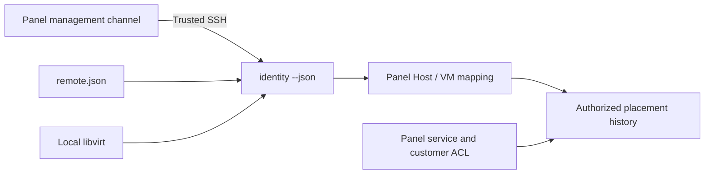

# Monitoring identity discovery (CLI contract v1)

[繁體中文](identity.zh-TW.md) · [Monitoring guide](../monitoring.md)

Run on each KVM Host using the existing trusted management channel, not on
Central or in a customer session. Update the existing `kvm-vm` CLI; no new
service or resource sampling is required.

## Identifier mapping

| Field | Source | Lifecycle |
|---|---|---|
| `host_id` | Agent/Hybrid `remote.json` | Generated on first remote deployment or preselected with `KVM_VM_MONITOR_HOST_ID`; retained across stops and mode changes |
| `vm_id` | libvirt Domain UUID | Stable across restart, rename and UUID-preserving migration; clone/recreation normally uses a new UUID |
| `service_id` | Panel business DB (not CLI output) | VPS service may survive recreation; Panel maintains mapping/history |



Identity returns discovery only, never grants ownership.

```sh
sudo kvm-vm identity
sudo kvm-vm identity --json
```

Example JSON (illustrative UUIDs):

```json
{
  "schema_version": 1,
  "host_id": "11111111-1111-4111-8111-111111111111",
  "host": "kvm-tpe-01",
  "site": "taipei",
  "domains": [
    {"name": "web01", "vm_id": "22222222-2222-4222-8222-222222222222"}
  ]
}
```

- `host_id`, `host`, `site` are persisted monitoring labels from
  `/etc/kvm-vm/monitoring/remote.json`, not machine IDs, hardware IDs, guessed
  hostnames or environment overrides. Set `KVM_VM_MONITORING_DIR` to the same
  custom directory as `setup-monitoring.sh` if applicable. The CLI does not
  read the password file, print the writer username or URL, or create a UUID.
- If `remote.json` is absent (e.g. local-only monitoring or before first
  Agent/Hybrid deployment), all three host fields are null. VM discovery
  still works. A stopped writer retains its saved identity. Do not enable
  central queries when Host ID is null.
- `domains` lists visible libvirt domains including inactive and unmanaged
  VMs, sorted by name. No domains returns `[]`. UUIDs come from one
  `virsh list --all --uuid --name` call. Use a management identity with full
  domain visibility; libvirt ACLs may hide domains from restricted users.
- The command accepts only the stock exporter's local `qemu:///system` URI.
  Run separately on each host (e.g. via existing trusted SSH), not against
  a remote libvirt URI. Reconcile customized exporter connections separately.

Exit 0 means a snapshot was returned, not that the writer is online, enrolled
or sending metrics. Invalid, unreadable, symlink or nonregular configuration,
failed/timed-out virsh and invalid/duplicate domain identities fail (exit 1,
diagnostic on stderr, no partial JSON). Libvirt enumeration has a 10s timeout;
callers should also enforce a process/SSH deadline.

Validate the schema version, exit status, canonical UUIDs and expected Host
mapping before using the snapshot. Keep Panel service IDs and historical
ownership/placement separate. Do not automatically transfer ownership, retire
VMs or rewrite history when a snapshot lacks an ID or differs from inventory.
A cloned Host must not reuse the source's remote monitoring configuration.
Discovery is not authorization or an atomic lifecycle snapshot; do not expose
it directly to customers. See [monitoring API contract](monitoring-api.md).
