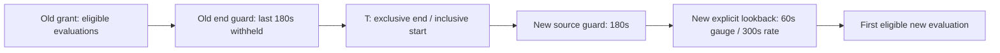

# External VM Panel monitoring API (contract v1)

External Panel integration uses the existing Prometheus-compatible Query API. It is an **opt-in
trusted service integration**, not a public customer API. See [ADR 0007](../adr/0007-external-panel-monitoring.md).

[繁體中文](monitoring-api.zh-TW.md) · [Monitoring architecture](../monitoring.md)

```mermaid
sequenceDiagram
    participant U as Customer browser
    participant P as Existing Panel Backend
    participant D as Panel ACL / placement DB
    participant Q as Private NGINX query ingress
    participant V as VictoriaMetrics Single
    U->>P: service ID, metric, time range
    P->>D: Authenticate session; authorize history
    D-->>P: Grant revision + placements (or deny)
    P->>P: Quota; bounded fixed query plan
    loop Each authorized placement
        P->>Q: GET query_range with service credential
        Q->>V: Fixed API path, trusted query parameters
        V-->>P: Scoped matrix via NGINX
    end
    P->>P: Validate identity/timestamps; normalize gaps
    P->>D: Reauthorize and compare grant
    D-->>P: Unchanged grant or deny
    P-->>U: Label-free points or sanitized error
```

The browser never reaches NGINX/TSDB directly. The Panel owns the business identity and policy; `kvm-vm identity --json` provides only trusted management discovery. For the separate write flow see [Central deployment](../central-monitoring.md).

## Install the optional query ingress

1. Keep `VM_PORT` on loopback and Grafana administrator-only. Use a dedicated
   private network/VPN address and firewall allowing only Panel backend IPs.
2. Install NGINX and apache2-utils. Create a **separate** password file, not the
   Remote Write or Grafana credential file. E.g. on Debian with NGINX worker
   group www-data (adapt to deployment):

   ```sh
   sudo install -d -o root -g www-data -m 0750 /etc/nginx/kvm-vm-panel
   sudo sh -c 'umask 077; htpasswd -B -C 10 /etc/nginx/kvm-vm-panel/htpasswd panel'
   sudo chown root:www-data /etc/nginx/kvm-vm-panel/htpasswd
   sudo chmod 0640 /etc/nginx/kvm-vm-panel/htpasswd
   ```

   If the file does not exist, initialize it with `htpasswd -cB -C 10` instead;
   never use `-c` on an existing file. Enter a random password interactively.
   Store it only in the Panel's server-side secret store. Use separate
   credentials for separate trusted Panel deployments; revoke on compromise.
3. Copy the reviewed [NGINX example](../../tools/monitoring/central/nginx-panel-query.example.conf),
   uncomment the server block, set private listener, DNS, allowed Panel IP,
   certificate/key and actual configured `VM_PORT`. Install as a dedicated TLS
   vhost, not a public/default vhost; check `nginx -t` and reload. Existing
   `render`/`up`/`sync-templates` seed the commented example but never enable it
   or overwrite a customized example. No extra service is added to Compose.
4. From the Panel test TLS trust, allowed IP and Basic Auth. Only GET
   `/api/v1/query_range` is forwarded. Write, instant query, series/labels,
   export, admin and other paths/methods are blocked. No request headers/body
   are forwarded, the upstream path is fixed, and caching is disabled. The
   trusted Panel may supply arbitrary query parameters at this endpoint; the
   endpoint is **not** a PromQL or tenant firewall. Use firewall restrictions,
   independent secret rotation, and global query concurrency/rate limits.
   Do not rely on a spoofable forwarded client IP. Review all other nginx
   vhosts/listeners and backend network reachability. Keep query strings,
   credentials and raw backend errors out of application/proxy logs.

## Stable contract

Discover the exact UUIDs with [`kvm-vm identity --json`](identity.md) on each KVM Host. A null Host UUID means central identity is not configured. Discovery is not proof of ownership.

[Versioned catalog](../../tools/monitoring/queries/v1.json) is the metric
allowlist, not a user-editable query language. [Python reference module](../../examples/monitoring_client.py)
uses it. Every selector matches exact canonical `host_id` and libvirt `vm_id`
(UUIDs), never the display name alone, tenant label or wildcard. Old samples
without UUID labels are not returned. Host ID must be the monitoring UUID,
not necessarily the Panel's own host database ID. No raw host-level, QEMU RSS,
physical backing-file sizes, cumulative counters, guest timestamp or topology
labels are returned. Guest memory is an estimate and only available with fresh
balloon stats, not assigned memory minus RSS.

| Metric IDs | Unit / meaning |
|---|---|
| cpu_cores / cpu_ratio / vcpus | cores, fraction of allocated vCPUs (1=100%), vCPU count |
| memory_assigned / memory_guest_used | bytes; assigned and estimated used are distinct |
| disk_capacity | bytes; sum of observed logical disk sizes, not guest filesystem usage |
| disk_read / disk_write | bytes/s |
| disk_read_iops / disk_write_iops | operations/s |
| network_receive / network_transmit | bytes/s, guest perspective (multiply by 8 for bits/s) |
| network_receive_packets / network_transmit_packets | packets/s |
| network_receive_errors / network_transmit_errors | errors/s |
| network_receive_drops / network_transmit_drops | packets/s |

Example generated queries (UUIDs are placeholders here):

```promql
rate_prometheus(kvm_vm_domain_cpu_time_seconds_total{host_id="HOST_UUID",vm_id="VM_UUID"}[300s])
/ on(host_id,vm_id,vm)
(last_over_time(kvm_vm_domain_vcpus{host_id="HOST_UUID",vm_id="VM_UUID"}[60s]) > 0)
last_over_time(kvm_vm_domain_memory_guest_used_bytes{host_id="HOST_UUID",vm_id="VM_UUID"}[60s])
rate_prometheus(kvm_vm_domain_disk_read_operations_total{host_id="HOST_UUID",vm_id="VM_UUID"}[300s])
```

The pinned VictoriaMetrics uses `rate_prometheus`, because MetricsQL `rate`
can read the raw sample immediately before the explicit range. Use Prometheus
`rate` only with a verified Prometheus-compatible engine implementing its
standard semantics (explicit `engine="prometheus"`); no automatic fallback.
Explicit lookback windows are 300s for rates and 60s for gauges. Do not use
implicit lookback, offset, subqueries, user-provided expressions or raw counter
values. References: [MetricsQL](https://docs.victoriametrics.com/metricsql/),
[Prometheus functions](https://prometheus.io/docs/prometheus/latest/querying/functions/).

## Panel integration (Python 3.10+)

Import from the repo root (or vendor the module and catalog with the same
relative layout). The module is a reference library, not a daemon/CLI.

```python
from examples.monitoring_client import QueryClient, PanelMonitoring, Grant, Placement

# Load from the Panel's trusted server-side configuration/secret store.
client = QueryClient(config.monitoring_url, secrets.monitoring_user,
                     secrets.monitoring_password, ca_file=config.monitoring_ca)

# Implement these callbacks with existing Panel DB, session and quota system:
# authorize(principal, service_id) -> Grant(revision, tuple[Placement, ...]) or None
# admit(principal, service_id) -> bool (quota/rate/concurrency admission)
monitoring = PanelMonitoring(client, authorize, admit)

# Inside an authenticated Panel API handler. Never take principal from JSON.
result = monitoring.read(session.principal, service_id, "cpu_ratio", start, end)
```

A possible customer route is `GET /api/v1/vms/{service_id}/metrics?metric=cpu_ratio&start=...&end=...`.
`service_id` is an opaque business resource identifier; do not accept browser
Host/VM UUIDs, tenant IDs, credentials, backend URLs or PromQL. Parse timestamps
as integer UTC Unix seconds; reject unknown params. Authenticate the session,
check current ACL, resolve the principal's authorized service history in a
transaction and pass **only** allowed intervals. `Grant` is immutable: revision
must change on every relevant ACL/ownership/placement change; `Placement` holds
(host UUID, domain UUID, inclusive start, exclusive end or None). Intervals
must be sorted, non-overlapping and known; unknown history is denied. Include
all authorized intervals across moves and rebuilds, never infer ownership from
VM names, metrics or current ownership alone. Use `None` for unauthorized or
unavailable policy. Phase 2 registry may still be used for independent operator
workflows, not a mandatory second customer database. No synchronization is
performed by this integration.

Results are `{"schema_version":1,"metric":"cpu_ratio","unit":"ratio","step":15,"points":[[unix_seconds,value_or_null],...]}`.
The requested end is inclusive; points lie on the start-aligned grid. The
client returns gaps as null, not invented zero. It strips all source labels,
sums observed device rates/capacities by timestamp, rejects ambiguous overlap
(including duplicated devices after rename) and validates every result's
Host/VM labels, timestamps and numeric values. Device totals may be partial
when an exporter lacks device statistics; not billing-quality usage. It does
not interpolate or sum across migrations. A long step samples the fixed
lookback at that time, not an average over the full display bucket.

Default limits: 30d range, 1000 points, min step 15s (automatically coarsened
if omitted), at most 16 placement intervals, 4 MiB upstream JSON per query,
10s socket timeout and 20s cooperative request budget. The Panel should also
set an absolute deadline and enforce authenticated per-user and per-service
rate/concurrency limits plus global limits. `admit` must be a real quota policy,
not `lambda: True` in production. No response cache is implemented; if adding
one, authorize on every hit, key on principal/ACL revision, complete placement
scope, metric, range, step and schema, and invalidate on ACL changes. Recheck
ACL after query before returning; the reference does this. Tie final response
publication to your policy transaction/revision as closely as practical;
revocation cannot retract data already delivered. Return sanitized 400 for
InvalidRequest, generic 403/404 for AccessDenied, and 502/503 for BackendError;
map quota to 429 if the surrounding Panel distinguishes it. No raw exception
or query details to browser; no shared HTTP response caching (`no-store`).

### History and source-time safety

Illustration for an ownership or placement boundary at `T`, using the default 180s guard and fixed lookback (not to scale):



| Query kind | Explicit lookback | Earliest new evaluation | Old closed interval |
|---|---:|---:|---|
| Gauge | 60s | T + 240s | Before T − 180s |
| Rate | 300s | T + 480s | Before T − 180s |

Actual output also follows the request's aligned evaluation grid. If the allowed interval is too short, return null; do not widen the query. The gap does not represent zero utilization. These are conservative limits of the reference implementation, not proof that source time is bounded.

Queries are planned separately for each authorized placement. The first
permitted evaluation is at least interval start + 180s source guard + explicit
lookback; a closed interval ends 180s before the exclusive end. The reference
intentionally leaves a boundary gap (up to 8 minutes after a rate transition)
rather than reading samples from the previous owner. The guard is a deployment
assumption: verify collector/scrape cadence, cache age, balloon freshness,
clock skew and source timestamp provenance keep uncertainty below 180s. If
unknown/unbounded, do not enable customer queries; increase the guard and
revalidate as required. Arbitrarily backdated/forged samples, overlapping active
placements, long exporter intervals and stale data cannot be made safe merely
by filtering a timestamp. The Panel's trusted sources must handle queue replay
and verified VM incarnation history. A compromised writer can fabricate its
own VM metrics; the shared TSDB is not independent tenant storage.

## Acceptance before any customer rollout

Run `python3 -m pytest tests/test_panel_monitoring.py tests/test_panel_query_ingress.py -q`.
The tests exercise the reference client against synthetic responses and the
actual TLS NGINX ingress against a fake upstream; they are not TSDB evidence.
Use [Panel acceptance checklist](../../tests/tenancy/panel-acceptance.md) with
the actual Panel/backend before enabling a customer feature. `customer-readiness`
remains BLOCKED (direct monitoring access). Do not change it or claim native
storage tenant isolation from this integration. Keep the prior Phase 5 suite
for future native tenancy comparison.
