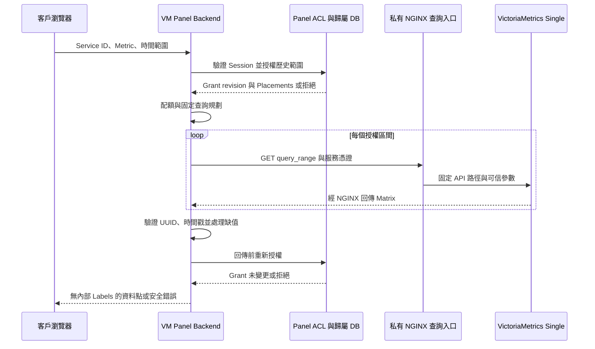
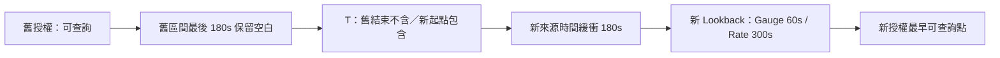

# 第三方 VM Panel 監控整合（契約 v1）

[English](monitoring-api.md) · [監控架構](../monitoring.zh-TW.md)

完整 API、設定範例與驗收規範請見
[英文整合文件](monitoring-api.md)。架構決策見 [ADR 0007](../adr/0007-external-panel-monitoring.zh-TW.md)。

VM Panel 負責登入、ACL、服務歸屬、歷史 VM/Host 映射及圖表；kvm-vm 保持採集、
Remote Write、中央儲存、管理員 Grafana。沿用 VictoriaMetrics Single，不新增常駐
API Server 或同步客戶資料庫。中央原有 Registry 可供獨立管理員使用；Panel 整合
時以 Panel 為權威來源。客戶不直接存取 PromQL、Grafana、TSDB 或服務憑證。

## 查詢流程與信任邊界



## 部署

選用 `tools/monitoring/central/nginx-panel-query.example.conf`，經人工審閱後部署於
獨立私有 TLS virtual host，限制 Panel IP、獨立 Basic Auth、有效憑證及防火牆。
僅轉送 `GET /api/v1/query_range` 至中央 loopback，其他路徑／方法拒絕，不轉送
外部 Header/Body、不快取。render/up 只放置未啟用的範本，不更改既有 NGINX。
不得將服務憑證給客戶或把任意 PromQL 轉送給後端：此服務帳號可查詢共享資料。
安裝 htpasswd、權限、TLS、輪替及 nginx -t/reload 指令見英文文件。

## Panel Backend 介面

`examples/monitoring_client.py` 為 Python 3.10+ 可匯入參考模組，使用版本化
`tools/monitoring/queries/v1.json` 指標清單。支援 18 種 CPU/vCPU、RAM、Disk 容量、
讀寫流量/IOPS、Network 流量/封包/錯誤/丟棄指標。採固定 Host UUID + Domain UUID
精確比對，並去除結果的內部 Labels；不提供原始累積計數、Host 層指標、任意查詢。


| Metric ID | 單位／意義 |
|---|---|
| `cpu_cores` / `cpu_ratio` / `vcpus` | 核心數／比例（1 = 100%）／vCPU 數 |
| `memory_assigned` / `memory_guest_used` | bytes；分配與 Guest 估計使用量不同 |
| `disk_capacity` | bytes；觀測到的邏輯磁碟大小，非 Guest 檔案系統使用量 |
| `disk_read` / `disk_write` | bytes/s |
| `disk_read_iops` / `disk_write_iops` | ops/s |
| `network_receive` / `network_transmit` | bytes/s，Guest 觀點 |
| `network_receive_packets` / `network_transmit_packets` | packets/s |
| `network_receive_errors` / `network_transmit_errors` | errors/s |
| `network_receive_drops` / `network_transmit_drops` | packets/s |

以 [v1.json](../../tools/monitoring/queries/v1.json) 為實際指標契約；不能使用任意 Metric 名稱。

```python
from examples.monitoring_client import QueryClient, PanelMonitoring

client = QueryClient(config.monitoring_url, secrets.monitoring_user,
                     secrets.monitoring_password, ca_file=config.monitoring_ca)
monitoring = PanelMonitoring(client, authorize, admit)
result = monitoring.read(session.principal, service_id, "cpu_ratio", start, end)
```

Panel 實作 `authorize(principal, service_id)`，由已驗證 session 與可信資料庫回傳
`Grant(revision, tuple[Placement, ...])` 或 None；Placement 記錄 Host/VM UUID 與 UTC
有效區間（含起點、不含結束）。`admit` 為實際查詢配額/並發控制。不得由前端傳入
principal、UUID、PromQL、後端 URL；未知歸屬或授權失敗拒絕查詢，查詢後重新授權。
回傳 `schema_version`、metric、unit、step 及 `points: [[timestamp, value_or_null],...]`；
缺值為 null，沒有資料不代表 0。CPU ratio 的 1 為 100%，流量單位 bytes/s。

| 限制 | 預設 |
|---|---|
| 查詢跨度 | 30 天 |
| 資料點 | 1,000，最小 step 15 秒，省略 step 時自動調整 |
| Placement 區間 | 16 段 |
| 每次上游 JSON | 4 MiB |
| Socket timeout / cooperative budget | 10s / 20s |
| 共享回應快取 | 無 |

另需 Panel 全域與每用戶／服務配額、並發限制及絕對逾時。不得將 `admit` 實作成無條件允許；若增加快取，每次命中仍須重新授權，鍵值須包含 ACL revision、principal、完整 Placement、metric、時間、step 及 schema。完整錯誤對應見英文契約。

## 歷史隔離及限制

以移交／Placement 邊界 T 為例（非比例圖）：



| 類別 | Lookback | 新區間最早評估時間 | 舊已關閉區間 |
|---|---:|---:|---|
| Gauge | 60s | T + 240s | 早於 T − 180s |
| Rate | 300s | T + 480s | 早於 T − 180s |

實際點仍須符合請求的 step 網格；區間太短時留空，不擴大授權範圍。空白不代表零使用量。

VM 改名以 UUID 辨識，遷移/重建由 Panel 保存 Placement 歷史，不推測未知歷史。
每個區間獨立查詢，顯式 rate window 300 秒、gauge 60 秒，另外保留 180 秒來源時間
安全緩衝，避免查到移交前的 Rate 或快取資料。VictoriaMetrics 原生 rate 會讀取
窗口前樣本，故採 `rate_prometheus()`；真正 Prometheus 引擎才設定使用 `rate()`。
180 秒是待實機驗證的時間不確定性上限，必須核對時鐘、採樣、Exporter cache、
balloon freshness 及可信 Writer；不符合時須停用客戶查詢或調整後重新驗證。
區間邊界可能有空白；不保證長時間圖表為完整桶平均，也不適用計費。

這是 Application-level Multi-tenancy，不是原生資料庫隔離。Panel 漏洞或被入侵
的基礎設施仍可能造成洩漏；尚未完成實機 TSDB 與實際 Panel 驗收。
`customer-readiness` 仍維持 BLOCKED，不開放中央客戶登入。先按
[Panel 驗收清單](../../tests/tenancy/panel-acceptance.md) 實測後再由管理員決定是否
開放 Panel 功能。原 Phase 5 安全契約保留，Phase 6 儲存後端 PoC 延後至確有需求時。

使用 [`kvm-vm identity --json`](identity.zh-TW.md) 從每台 KVM Host 取得監控 UUID；Host UUID 為 null 時不得啟用中央查詢。識別快照不代表客戶歸屬。
