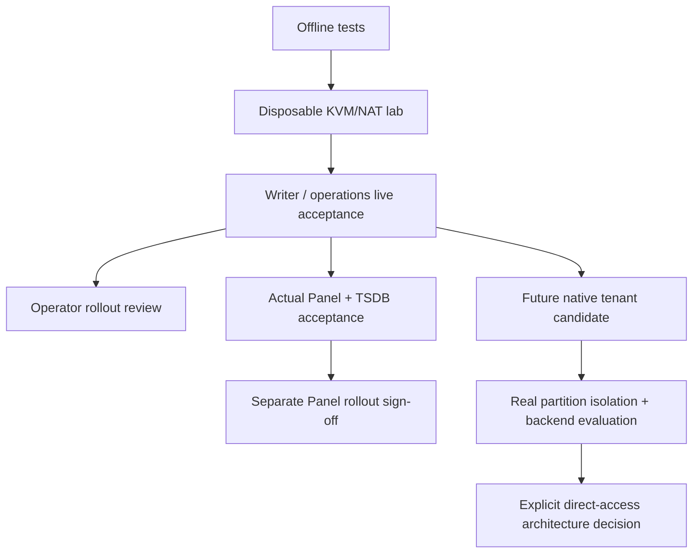

# Monitoring acceptance and evidence

[繁體中文](monitoring-acceptance.zh-TW.md) · [Monitoring architecture](monitoring.md)

Implementation, offline validation, live integration, and production acceptance are distinct. Use this guide to select the correct tests; it does not certify the current checkout. Record the exact Git commit, image tags/digests, environment, topology, start/end time, measured results and PASS/FAIL/NOT RUN per case. Keep sanitized reports, never lab state, credentials, CA keys or webhook secrets.

## Which acceptance gate?

| Target | Required evidence | Instructions |
|---|---|---|
| Local VM collection | Actual libvirt sampling, VM UUID discovery, counters, null/absent semantics, dashboard | [Exporter](prometheus.md), [Identity CLI](integration/identity.md) |
| Central operator deployment | Dual NAT, TLS/auth, samples, identity, offline detection, mode switch | [KVM/NAT lab](../tests/e2e/README.md) |
| Production writer/operations | Real host binding, rotation/revocation, raw timestamp replay, overflow, observer and restore | [Security and reliability](monitoring-security-reliability.md), [extended drills](../tests/e2e/README.md#extended-drills) |
| Existing external Panel | Actual Panel ACL, historical scope, pinned TSDB query semantics, trusted source time, network isolation, quotas | [Panel live acceptance](../tests/tenancy/panel-acceptance.md) |
| Future native storage tenancy | Real candidate-specific provisioning, storage partition oracle, arbitrary PromQL/metadata isolation, spoofing, handoff, cache and revocation | [Tenant security contract](../tests/tenancy/README.md) |



A passing Panel gate does not unblock direct Central customer access; `customer-readiness` remains BLOCKED (exit 2). The native tenancy branch is deferred, not implemented by the Panel query endpoint. An offline self-test or synthetic NGINX upstream test is not proof of actual storage semantics or tenant isolation.

## Run offline checks

From the repo root (see [general testing guide](../tests/README.md) for requirements):

```sh
python3 -m pytest tests -q
bash tests/smoke.sh
python3 -m pytest tests/test_monitoring_e2e_lab.py tests/test_tenant_security_contract.py tests/test_panel_monitoring.py tests/test_panel_query_ingress.py tests/test_identity_cli.py -q
./tests/e2e/lab.sh plan
./tools/setup-central-monitoring.sh customer-readiness  # expected exit 2
```

NGINX and bcrypt tests require their local executables; inspect skips. The real Panel itself is not included in this repo. The common native tenancy runner needs a disposable configured candidate and real storage oracles; missing prerequisites are BLOCKED, not PASS.

## Historical evidence and remaining live validation

The earlier 2026-11-18 single-physical-host multi-NAT evidence, recorded in the [foundation specification](work/20261124_monitoring-foundation/spec.md), reports 9/9 base lab scenarios, writer recovery, two independent Single host-level handoff, and approximately 86 seconds for blank-guest recovery under prepared conditions. The source archive was external to Git. These results are historical, not retests of the current commit, not real cross-site DR or a production RTO. Do not infer VM-level isolation from the older host-level handoff.

The current repo includes the managed-writer and long-outage drill code, the native tenant contract, Panel reference client/ingress tests and identity tests. They still require live validation appropriate to the deployment: actual pinned TSDB host binding and lookback semantics, real libvirt, 1/24/72h outages, queue capacity/status codes, actual notification delivery, independent offsite DR and Panel integration. Initial RPO/RTO targets are planning assumptions, not measured guarantees. See [Security and reliability](monitoring-security-reliability.md#independent-observer-backup-and-recovery). Track the release's actual results separately; do not change historical evidence to imply a new pass.
