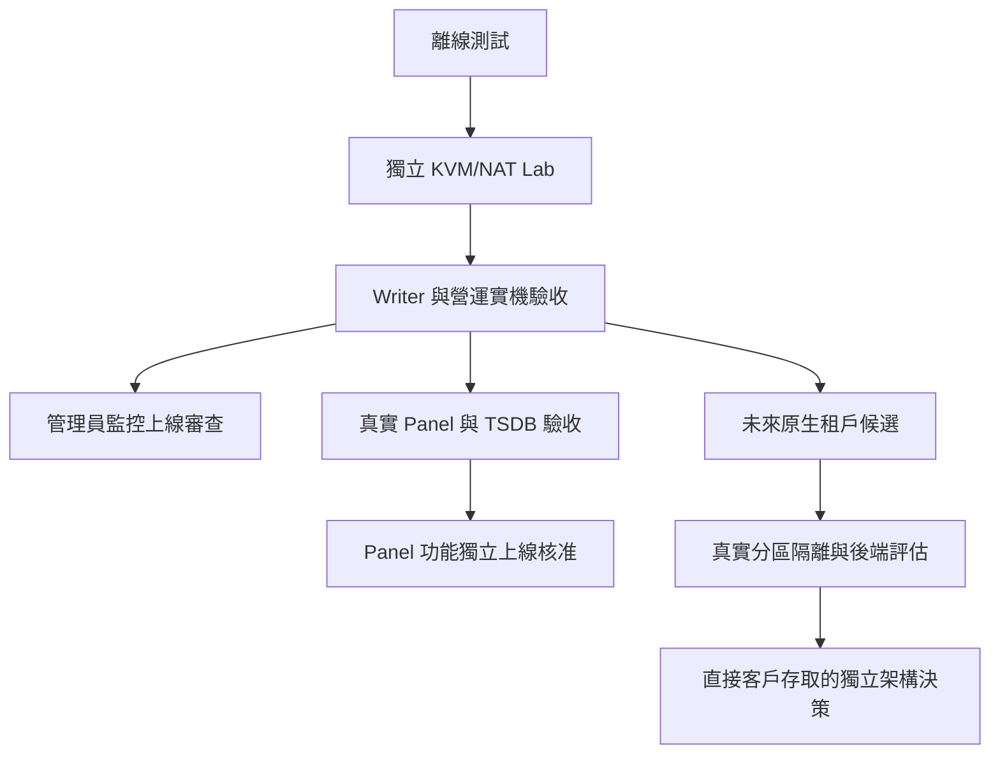

# 監控驗收與證據

[English](monitoring-acceptance.md) · [監控架構](monitoring.zh-TW.md)

程式已實作、離線測試通過、實機整合通過及正式環境驗收是不同層級。本指南用於選擇測試，並非當前版本的驗收證明。每次執行需記錄 Git commit、Image tag/digest、硬體及拓樸、起訖時間、量測資料、各案例 PASS／FAIL／NOT RUN；只保存去除機密的證據，不上傳 Lab 狀態、CA 私鑰、憑證及 Webhook URL。

## 選擇驗收路徑

| 目標 | 必要證據 | 操作文件 |
|---|---|---|
| 本機採集 | 實際 libvirt、UUID、指標與缺值、Dashboard | [Exporter](prometheus.zh-TW.md)、[Identity CLI](integration/identity.zh-TW.md) |
| 中央管理員監控 | 雙 NAT、TLS／認證、樣本、失聯、模式切換 | [KVM/NAT Lab](../tests/e2e/README.zh-TW.md) |
| 正式 Writer 與營運 | 真實 Host 綁定、輪替／撤銷、原始時間戳補傳、佇列滿載、Observer、還原 | [安全與可靠性](monitoring-security-reliability.zh-TW.md)、[延伸演練](../tests/e2e/README.zh-TW.md) |
| 既有 VM Panel | 實際 Panel ACL、歷史範圍、指定 TSDB 查詢語義、來源時間、網路隔離、配額 | [Panel 實機驗收](../tests/tenancy/panel-acceptance.md) |
| 未來原生儲存隔離 | 真實候選部署及儲存分區查詢、任意 PromQL／metadata 隔離、偽造、移交、快取、撤銷 | [租戶安全契約](../tests/tenancy/README.zh-TW.md) |



Panel 驗收通過也不會解除中央直接客戶登入的限制；`customer-readiness` 維持 BLOCKED（exit 2）。原生租戶路徑已延後，並非私有 Panel 查詢入口的功能。離線模型測試或 NGINX 搭配模擬儲存端不能證明真實 TSDB 的查詢語義及租戶隔離。

## 離線檢查

在 Repo 根目錄執行（需求見[通用測試指南](../tests/README.zh-TW.md)）：

```sh
python3 -m pytest tests -q
bash tests/smoke.sh
python3 -m pytest tests/test_monitoring_e2e_lab.py tests/test_tenant_security_contract.py tests/test_panel_monitoring.py tests/test_panel_query_ingress.py tests/test_identity_cli.py -q
./tests/e2e/lab.sh plan
./tools/setup-central-monitoring.sh customer-readiness  # 預期 exit 2
```

NGINX、bcrypt 測試需本機相關工具，請留意 skip。Repo 不包含實際第三方 Panel。原生租戶共用 Runner 需配置隔離候選系統及真實儲存端查詢，缺少前置條件為 BLOCKED，不是 PASS。

## 歷史證據及待驗收項目

[Foundation SPEC](work/20261124_monitoring-foundation/spec.md) 記載 2026-11-18 單一實機多 NAT 報告：基礎情境 9/9、Writer 恢復、兩套獨立 Single 的 Host-level 移交，以及預備條件下約 86 秒空白 Guest 還原。原始證據包在 Git 之外。這些是歷史結果，不是當前版本重測、真正異地 DR 或正式 RTO；舊 Host-level 移交不能證明 VM-level 租戶隔離。

現行 Repo 包含 Managed Writer 與長時間中斷演練程式、原生租戶驗收契約、Panel 參考 Client／入口測試及 Identity 測試。實際部署仍需完成相應驗收：指定 TSDB 的 Host 綁定及 Lookback 語義、真實 libvirt、1／24／72 小時斷線、Queue 容量與狀態碼、通知送達、異地還原及真實 Panel。RPO/RTO 初始值只是驗收目標，不是實測保證，見[安全與可靠性](monitoring-security-reliability.zh-TW.md)。另存各次版本的測試結果，不改寫歷史證據。
