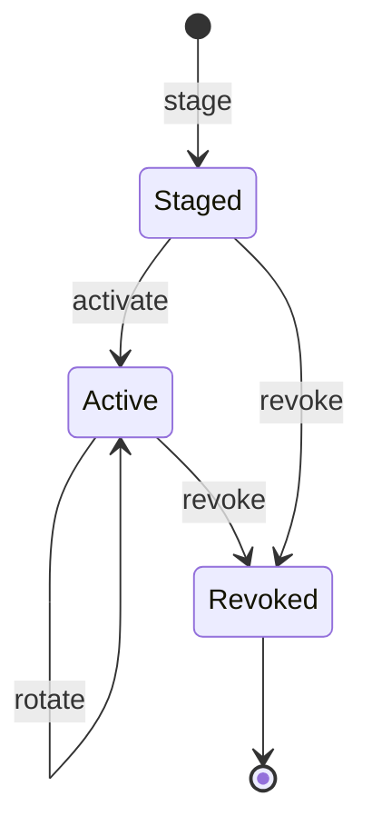
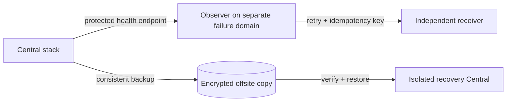

# Central monitoring security and reliability

[繁體中文](monitoring-security-reliability.zh-TW.md) · [Monitoring architecture](monitoring.md)

This guide covers the **operator-managed monitoring stack**. Central stays on the shared, administrator-only VictoriaMetrics Single. No native tenant routing or direct customer authorization. The separate [Panel integration](integration/monitoring-api.md) uses application-level authorization and has its own acceptance gate. The optional managed writer ingress binds a credential to a Host UUID, not a VM or tenant. The existing lab registration/relay implementation and legacy `enroll`/ingress are preserved. **Do not expose any shared storage/Grafana endpoint to customers.**

## Managed writer lifecycle (opt-in)



Install `apache2-utils` (local `htpasswd`) on Central. A dedicated TLS virtual host and NGINX worker group are required. Central's actual inventory must already contain the Host UUID. On the Host, obtain the UUID with [`kvm-vm identity --json`](integration/identity.md) or choose it before first deployment with `KVM_VM_MONITOR_HOST_ID`. Inventory enable/disable is an alerting operation, **not** authentication revocation. Revoke before removing a host from inventory; `writers check` detects orphaned active bindings but does not revoke them automatically.

```sh
sudo ./tools/setup-central-monitoring.sh writers init www-data
sudo ./tools/setup-central-monitoring.sh writers stage HOST_UUID
# Save the printed username. Create a fresh random 16–72 byte ASCII password in
# a private file (e.g. umask 077; openssl rand -hex 24 > /root/writer-password).
sudo sh -c './tools/setup-central-monitoring.sh writers activate USERNAME < /root/writer-password'
sudo ./tools/setup-central-monitoring.sh writers list
sudo ./tools/setup-central-monitoring.sh writers check
```

The managed writer credential snapshot lives in `/etc/nginx/kvm-vm-writers/htpasswd`, in a 0750 owner-controlled directory with the chosen NGINX group. The live file is 0640, contains only bcrypt verifiers for active registrations and JSON audit comments. Staging produces an immutable name `HOST_UUID.random_id`; one active writer per host. A revoked name cannot be reused. Atomic replacement, stable directory lock, and fsync protect updates; password hashing failure leaves the old file unchanged. `list` never emits verifiers. Protect the directory, backups, and parent directories from untrusted writes. `KVM_VM_WRITER_DIR` is for explicitly managed alternate directories; the NGINX file path must match. `check` checks disk state against inventory, not live traffic or NGINX reload. Root-managed lifecycle, no new HTTP management API.

Review `tools/monitoring/central/nginx-managed-writers.example.conf`. Include its `map` in the HTTP context and configure the dedicated TLS virtual host; uncomment/adapt the example server, certificate, host, and local VictoriaMetrics port. Run `nginx -t` before reloading. Do not mix the legacy and managed location on the same public endpoint. Keep VictoriaMetrics bound to loopback. The authenticated username supplies the immutable UUID; the proxy replaces the whole upstream query string with a fixed write path and `extra_label=host_id=...`, strips Authorization, permits only POST, and reads the same live htpasswd snapshot (no copying/synchronization or reload per credential change). Existing NGINX config is not automatically modified by the tool; on config failure retain the old listener and restore the reviewed config. The legacy `enroll` path is unaffected; migrate hosts individually and retire the old ingress after verification. Never restore a stale credential snapshot to an active ingress without reconciling revocations.

This host-label mechanism is specific to the current Single receiver: the pinned v1.154.1 insertion code appends `extra_label` after supplied labels, and canonical tag deduplication keeps the last value. The optional `managed_writer_drill.py` must verify this against the real pinned backend and be rerun after upgrades. The offline NGINX test proves authentication and fixed upstream URL, **not** storage enforcement. Host credentials still allow a compromised host to fabricate metrics/VM identifiers; neither payload `tenant_id`, `vm_id`, nor arbitrary other labels or metric names are trusted authorization data. Customer readiness remains BLOCKED. This is not an untrusted-tenant ingestion boundary or a substitute for future per-sample ownership checks. See upstream [write handler](https://github.com/VictoriaMetrics/VictoriaMetrics/blob/v1.154.1/app/vminsert/promremotewrite/request_handler.go) and [tag canonicalization](https://github.com/VictoriaMetrics/VictoriaMetrics/blob/v1.154.1/lib/storage/metric_name.go).

### Rotate without changing destination or queue

Coordinate both endpoints; do not send queued data with an invalid password. First check pending samples on Host and let the queue drain when possible. Stop the **same** active deployment with `down --mode agent` (or hybrid), retaining its volumes. Generate a fresh password in a root-private file, transfer securely (never argv, chat, logs or git). On Central:

```sh
sudo sh -c './tools/setup-central-monitoring.sh writers rotate USERNAME < /root/new-writer-password'
```

On Host:

```sh
sudo sh -c './tools/setup-monitoring.sh replace-password --mode agent < /root/new-writer-password'
sudo ./tools/setup-monitoring.sh up --mode agent
sudo ./tools/setup-monitoring.sh diagnostics --mode agent
```

Replace `agent` with `hybrid` for that mode. `replace-password` requires no mode/pending marker and no Compose-managed writer containers, validates stdin, atomically replaces only the password, and never deletes volumes or changes username, URL or UUID. The parent directory remains private; password mount is readable inside the container. Unset obsolete password-file environment variables. Confirm old credential is rejected and fresh successful samples arrive at Central; remove temporary password files. If the Host update fails, leave writer stopped, correct it and retry. Never retry indefinitely with wrong credentials. A same-name rotation is not tenant reassignment; a new registration requires revoking the old one and a reviewed remote.json username change/reconfigure after queue reconciliation. For endpoint or tenant changes, drain/verify or quarantine the old queue; do not reuse pending samples with new ownership. Revocation: `writers revoke USERNAME` (terminal, idempotent). Already authorized in-flight requests can finish; stop writer first for a planned cutover. `check` validates disk inventory, not in-flight status.

## Writer diagnostics and queue policy

```sh
sudo ./tools/setup-monitoring.sh diagnostics --mode agent
sudo ./tools/setup-monitoring.sh diagnostics --mode hybrid
```

Run on the corresponding Host; no Central network request, no secret or label output. JSON reports selected counters, local HTTP reachability and exporter success; missing values are `null`. Agent shows pending bytes, configured capacity, a comparison ratio, discarded bytes, rejected blocks, dropped samples and push failures. Hybrid shows pending samples, failed/dropped/retried samples and estimated send lag. Exit 1 means local endpoint or collector failure, not end-to-end delivery success. Queue counters can reset on restart and missing series are not zero; verify raw central samples and actual volume free space separately.

Agent queue default is 2 GiB per URL. `KVM_VM_REMOTE_DISK_QUEUE_LIMIT` accepts integer bytes (512 MiB–1 TiB); set on first render or explicitly reconfigure. Existing configured limit is retained on reconfigure. Example (review previous custom files and private CA mounts first):

```sh
sudo ./tools/setup-monitoring.sh down --mode agent
sudo env KVM_VM_REMOTE_DISK_QUEUE_LIMIT=4294967296 KVM_VM_REMOTE_RECONFIGURE=1 \
  ./tools/setup-monitoring.sh render /etc/kvm-vm/monitoring --mode agent
# Review and restore required custom settings before starting.
sudo ./tools/setup-monitoring.sh up --mode agent
```

Do not override `REMOTE_DISK_QUEUE_LIMIT` directly in the Compose process environment. vmagent's cap is not a filesystem quota; reserve headroom and size using measured ingestion rate and outage budget. Full queues discard oldest data. Hybrid is Prometheus WAL-based and not guaranteed to replay a multi-hour/day outage; it scrapes allowlisted `prometheus_remote_storage_*` self-metrics and retries 429. See [vmagent persistence](https://docs.victoriametrics.com/vmagent/#on-disk-persistence) and [Prometheus remote write tuning](https://prometheus.io/docs/practices/remote_write/). HTTP 401/403/429/503 behavior differs by writer and version; measure and record errors, retries and actual stored samples, not assumed losslessness.

Follow the reviewed [upgrade procedure](central-monitoring.md#7-upgrade-existing-deployments) to apply updated templates and preserve custom CA/configuration. No new public ports. Delayed sample age can reflect network delay **or** clock skew; independently verify NTP on each host. Central self-monitoring cannot alert reliably when Central is down or the only delivery channel is disconnected.

## Independent observer, backup and recovery



Install `examples/kvm-vm-central-observer.service` on a **different** host/failure domain. Create dedicated non-login `kvm-vm-observer` system account/group, install `watch-central.py` under `/usr/local/libexec/kvm-vm/`, and make `/etc/kvm-vm-observer/` root-owned with group read/traverse only. Provide group-readable 0640 `health-url` and `webhook-url`, one HTTPS URL per file. Health endpoint must return HTTP 200 and `OK`; restrict it to the observer; use a valid certificate and TLS verification. For a private CA use a reviewed systemd override with `--ca-file`, not disabled validation. StateDirectory is persistent and private. The observer retries pending notifications with an idempotency key; the receiver must deduplicate. Enable manually after testing; never place secrets in unit args, source control, or test evidence. An endpoint health check does not prove queries, ingestion or notifications are fully operational.

Suggested initial acceptance targets, **not measured SLOs**: daily encrypted offsite backup (RPO ≤24h for restorable configuration and stored data), recovery to queryable Central within 60 minutes from declaration including transfer, DNS/TLS and verification; adjust after actual offsite drill. Set separate remote-write queue outage budget; buffered samples beyond RPO depend on sender, capacity and retries. Back up Central configuration (`inventory`, `registry`, `.env`, alert receiver settings), VictoriaMetrics and Grafana volumes consistently, plus external NGINX configs, managed writer snapshot, TLS material, and independent observer config/state. Quiesce writers or use a supported storage-specific snapshot; do not copy live TSDB files as if consistent. Encrypt backups, restrict access, verify checksums, and keep offsite. Treat auth snapshots as secrets; reconcile post-backup rotations/revocations before enabling restored ingress. Restore into isolated blank environment, check UID/permissions, ownership histories, actual raw samples, dashboards, cert trust, old revoked credentials, new writer upload and resolved notification. Existing `tests/e2e/recovery_drill.py` remains a lab-only cold backup/restore proof; it does not back up external managed ingress and does not establish offsite RTO. No generic production backup command is introduced until operational storage/retention are selected.

## Acceptance

Use [Monitoring acceptance](monitoring-acceptance.md) and the [extended Lab drills](../tests/e2e/README.md#extended-drills) for current commands, raw-sample evidence and remaining manual tests.
