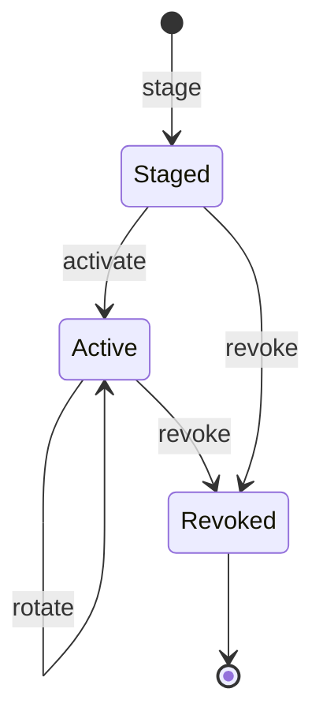
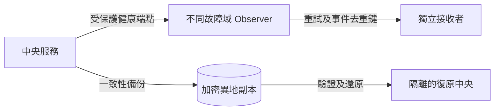

# 中央監控安全與可靠性

[English](monitoring-security-reliability.md) · [監控架構](monitoring.zh-TW.md)

中央維持 VictoriaMetrics Single、管理員專用；`customer-readiness` 仍為 BLOCKED。不提供原生租戶隔離或直接中央客戶登入；外部 Panel 的應用層隔離見[獨立整合契約](integration/monitoring-api.zh-TW.md)。詳細操作、安全限制及實機驗收見 [英文操作指南](monitoring-security-reliability.md)。

## Writer 憑證



中央先安裝 `apache2-utils`，並將 Host UUID 登錄既有 Inventory。選用新管理入口：

```sh
sudo ./tools/setup-central-monitoring.sh writers init www-data
sudo ./tools/setup-central-monitoring.sh writers stage HOST_UUID
sudo sh -c './tools/setup-central-monitoring.sh writers activate USERNAME < /root/writer-password'
sudo ./tools/setup-central-monitoring.sh writers list
sudo ./tools/setup-central-monitoring.sh writers check
```

密碼由管理員產生（16–72 bytes 可列印 ASCII，建議隨機 48 字元），經私有檔案與 stdin 提供。預設 `/etc/nginx/kvm-vm-writers/htpasswd` 同時保存不可變 Host UUID 綁定、bcrypt 驗證值及生命週期紀錄；目錄 0750、認證檔 0640，由指定 nginx group 讀取。使用原子更新、鎖與 fsync；同一 Host 只允許一個有效 Writer，撤銷不可反轉。舊 `enroll` 及 Lab 工具仍維持原行為。

審閱 `tools/monitoring/central/nginx-managed-writers.example.conf`：在專用 HTTPS virtual host 啟用認證與固定寫入路徑，禁止 query 路徑，覆蓋客戶端 query string，從認證 username 取得 Host UUID。工具不會自動改動 nginx；先 `nginx -t`，再 reload，保留回滾設定。之後 rotate/revoke 不需複製認證檔。NGINX 代理測試已可在本機執行，但必須重跑 `managed_writer_drill.py` 確認實際 pinned Single 的 Host Label 覆寫。Host/VM/Tenant labels 並非完整授權機制；惡意 Host 仍可偽造其他 metrics，**禁止客戶直接存取共享資料庫**。Inventory disable 只控制預期在線告警，不是撤銷憑證；移除 Host 前須先撤銷。`writers check` 只檢查檔案與 Inventory，不代表線上認證已驗證。

輪替：先檢查與盡量排空 queue，停止目前的 Agent/Hybrid (`down` 保留 volumes)。中央 `writers rotate USERNAME`、Host `replace-password --mode agent` 皆以 stdin 傳入同一新密碼，再啟動原模式。Hybrid 改用 `--mode hybrid`。Host 更新需確認沒有模式標記及殘留 Compose Writer，不改 UUID、URL、username 或 queue。若更新失敗，保持停止並修復；不要讓 Writer 持續使用錯誤密碼上傳。確認舊密碼失效及中央新樣本後移除臨時密碼檔。撤銷 `writers revoke USERNAME`；已授權的 in-flight 請求可能完成。跨租戶或 URL/username 變更須另行處理舊佇列，不能直接轉交新租戶。

## 診斷、佇列與告警

```sh
sudo ./tools/setup-monitoring.sh diagnostics --mode agent
sudo ./tools/setup-monitoring.sh diagnostics --mode hybrid
```

本機 JSON 診斷不依賴中央可用；缺少資料回傳 null，包含 Agent 積壓 bytes、設定容量與丟棄指標、Hybrid pending samples、估算傳輸延遲與錯誤。不能以 HTTP 可達或 exit 0 認定中央已收到資料。Agent 預設 2 GiB，每 URL 限制，`KVM_VM_REMOTE_DISK_QUEUE_LIMIT` 允許 512 MiB–1 TiB 的整數 bytes；不是磁碟硬配額。超過佇列容量可能丟棄最舊資料。Hybrid 使用 WAL，不能保證長時間中斷完整補傳；新增 allowlisted 自身 Remote Write 指標及 HTTP 429 retry。既有部署需備份客製設定、審閱並重新渲染；注意私人 CA 掛載不得遺失。

中央新增元件 self-scrape、Queue 丟棄／拒絕、Hybrid 失敗／延遲、中央低磁碟空間等告警，Fleet Dashboard 新增相關圖表。審閱 `sync-templates` 再 `reload`。中央完全中斷時需在 Host 本機診斷，並由不同故障域的獨立 Observer 通知。使用新增 `examples/kvm-vm-central-observer.service` 選用範例；詳細權限、HTTPS、CA 及狀態保存見英文文件。

## 備份與恢復



先設定建議驗收目標 RPO 24 小時、RTO 60 分鐘（**目標，不是實測保證**），依異地演練調整。備份包含中央設定、Inventory、Ownership Registry、Grafana/TSDB volumes、外部 NGINX 與 managed writer 憑證快照、TLS、告警及 Observer 設定／狀態。採一致性備份、加密、異地保留及 checksum；不要直接複製運行中的 TSDB 當成可靠備份。還原後先核對備份後發生的 rotate/revoke，再啟用入口。既有同實機空白 VM 還原演練並非真正異地 DR，現階段不新增通用生產備份指令。

## 驗收

請依[監控驗收](monitoring-acceptance.zh-TW.md)及[實機 Lab 延伸演練](../tests/e2e/README.zh-TW.md)執行；實機測試指令與證據規格集中於測試文件。
