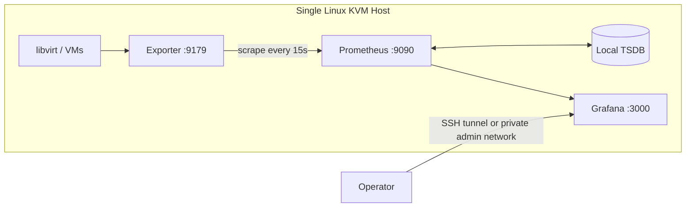

# One-command Docker monitoring for local VMs

`tools/setup-monitoring.sh` connects the native read-only `kvm-vm exporter` to **Prometheus + Grafana** using Docker Compose on the same Linux KVM/libvirt host. It monitors **all local libvirt VMs by default**, including VMs not created by kvm-vm. No VM-side agent is required.

[繁體中文](monitoring-stack.zh-TW.md) · [Monitoring architecture and modes](monitoring.md)



Local does not upload centrally or bundle node_exporter. For central history use [Agent/Hybrid](central-monitoring.md).

## Requirements

- Linux host with working libvirt/`virsh`, Python 3, systemd, and root access.
- Running Docker Engine with the `docker compose` v2 plugin. This script **does not install Docker** or reconfigure the host firewall/network.
- A checkout of this repository. If kvm-vm is not installed, `up` runs the repository's `install.sh`. Upgrade an existing older installation with `sudo ./install.sh` if it lacks `exporter`.

## Quick start

```bash
sudo ./tools/setup-monitoring.sh           # same as: up
sudo ./tools/setup-monitoring.sh credentials
```

The first run creates `/etc/kvm-vm/monitoring/` with Compose, scrape configuration, a Grafana datasource and a preprovisioned **KVM VM Overview** dashboard. A random initial Grafana administrator password is stored in the root-only `.env` file (0600). The exporter listens at `127.0.0.1:9179`; an existing working kvm-vm exporter is reused instead of starting a duplicate (including any existing `--managed` VM filter). Prometheus listens at `127.0.0.1:9090` and Grafana at `127.0.0.1:3000`. Prometheus scrapes every 15 seconds and retains samples for 15 days by default.

Open `http://127.0.0.1:3000` on the host. The `credentials` subcommand displays the **initial** password, which may no longer be valid after a password change inside Grafana. Editing `.env` does not reset Grafana credentials after the initial DB setup. Keep `.env` private.

## Management

```bash
sudo ./tools/setup-monitoring.sh up       # start / reconcile the stack
sudo ./tools/setup-monitoring.sh status   # status
sudo ./tools/setup-monitoring.sh logs     # follow container logs
sudo ./tools/setup-monitoring.sh down     # stop; preserve history
sudo ./tools/setup-monitoring.sh update   # pull the configured image tags and recreate
```

`down` preserves Docker data volumes and never stops an exporter not installed by this tool. Running `up` or `update` does not overwrite existing configuration files, dashboards, or `.env`. To upgrade to newer image versions, edit the image tags in `/etc/kvm-vm/monitoring/compose.yaml`, then run `update` after making backups. Initial pins are `prom/prometheus:v3.16.0` and `grafana/grafana:13.3.1` (OSS).

Local configuration is in `/etc/kvm-vm/monitoring/`. Named volumes are `kvm-vm-monitoring_prometheus_data` and `kvm-vm-monitoring_grafana_data`.

Before the **first** deployment, you can change the UI ports or retention:

```bash
sudo env GRAFANA_PORT=3100 PROMETHEUS_PORT=9190 PROMETHEUS_RETENTION=30d \
  ./tools/setup-monitoring.sh up
```

Subsequently edit `/etc/kvm-vm/monitoring/.env` and run `up`. Exporter port `9179` is fixed. For an offline configuration preview without Docker or root:

```bash
./tools/setup-monitoring.sh render /tmp/kvm-vm-monitoring-preview
```

## Dashboard and diagnostics

The dashboard displays running VM count, VM CPU percentage and cores used, assigned memory vs. guest-used memory, QEMU RSS, disk/network byte rates, disk capacity, and collection status. VM name and UUID filtering are included. Disk IOPS, mean request time, network packet rate, errors and drops are also provided. Disk and network rates use PromQL `rate()` over native counters. Missing first-sample CPU or stale guest balloon statistics are left unknown (not displayed as zero).

```bash
curl -fsS http://127.0.0.1:9179/metrics | grep kvm_vm_collector_success
curl -fsS http://127.0.0.1:9090/-/ready
curl -fsS http://127.0.0.1:3000/api/health
sudo journalctl -u kvm-vm-monitoring-exporter --no-pager -n 50
```

## Security and remote access

Docker `network_mode: host` is used so Prometheus can reach the localhost-only exporter. Grafana and Prometheus themselves **bind only to 127.0.0.1** and are not externally published. Host networking shares the Linux host network namespace and should only be used with trusted container images; `ports:` must not be specified. See the [Docker documentation](https://docs.docker.com/engine/network/drivers/host/).

For remote access, open an SSH tunnel on your workstation:

```bash
ssh -L 3000:127.0.0.1:3000 user@kvm-host
```

Then browse `http://127.0.0.1:3000`. For an alternative Tailscale/reverse-proxy setup, configure TLS, authentication and access restrictions. Never expose the exporter or Prometheus directly to the public internet. On SELinux enforcing hosts, bind mounts may need additional policy/labeling adjustments; the script does not automatically loosen SELinux security.

See [Prometheus metrics](prometheus.md) for individual metric semantics.

### Updating dashboards

Back up the saved dashboard and provisioning configuration, review `tools/monitoring/grafana/dashboards/kvm-vm.json`, and replace the saved `grafana/dashboards/kvm-vm.json` in the monitoring directory if appropriate. Restart/recreate Grafana (or stop/start the same stack) to apply it. `up`/`update` alone preserve custom dashboard files. Upgrade the installed CLI and restart the managed exporter service if it is running; reconcile a manually installed exporter separately. Existing data volumes remain; a new `vm_id` label creates new series. See [metric upgrade notes](prometheus.md#vm-identity-and-upgrade).
