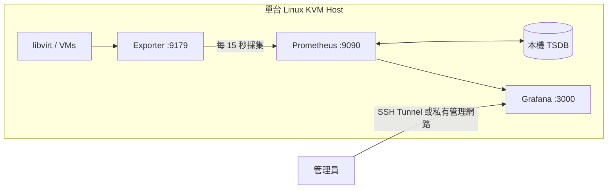

# 使用 Docker 快速建立本機 VM 監控

`tools/setup-monitoring.sh` 將既有 `kvm-vm exporter` 與 Docker Compose 的 **Prometheus + Grafana** 整合在同一台 Linux KVM/libvirt 宿主機上。VM 不需安裝 Agent，監控屬唯讀操作；預設監控 **本機所有 libvirt VM**（不限於 kvm-vm 建立的 VM）。

[English](monitoring-stack.md) · [監控架構及模式比較](monitoring.zh-TW.md)



Local 不上傳中央、也不內建 node_exporter。需中央歷史請選用 [Agent／Hybrid](central-monitoring.zh-TW.md)。

## 需求

- Linux KVM 宿主機、`virsh`（libvirt-clients）、Python 3、systemd，以及以 root 執行腳本的權限。
- **已安裝且可連線的 Docker Engine 與 `docker compose` v2 插件。** 本腳本不會自行安裝 Docker 或修改宿主機網路／防火牆。
- 本專案的工作目錄。若未找到已安裝的 `kvm-vm`，`up` 會執行專案內的 `install.sh` 安裝指令；若找到的版本不支援 `exporter`，請先執行 `sudo ./install.sh` 更新。

## 一鍵部署

在專案目錄執行：

```bash
sudo ./tools/setup-monitoring.sh
# 與 sudo ./tools/setup-monitoring.sh up 相同
```

首次執行會：

1. 在 `/etc/kvm-vm/monitoring/` 建立 Compose、Prometheus scrape 設定、Grafana datasource 與 Dashboard；新增 `.env`（權限 0600，內含隨機產生的管理員初始密碼）。
2. 啟用本機 `kvm-vm` Exporter 的 systemd 服務，監聽 `127.0.0.1:9179`。如偵測到既有的 `kvm-vm` Exporter，則沿用、不建立第二個搶占同一連接埠的服務；如既有服務使用 `--managed`，則沿用它原本的 VM 篩選限制。
3. 使用 Docker Compose 啟動 Prometheus（`127.0.0.1:9090`）與 Grafana（`127.0.0.1:3000`）。
4. 自動匯入 **KVM VM Overview** Dashboard；每 15 秒抓取指標，Prometheus 預設保留 15 天歷史資料。

瀏覽器在宿主機上開啟 `http://127.0.0.1:3000`。查看首次建立的登入資訊：

```bash
sudo ./tools/setup-monitoring.sh credentials
```

管理員密碼第一次登入後可以在 Grafana 內更改。`credentials` 顯示的是 **首次部署時產生的密碼**，不是 Grafana 內變更後的密碼。請妥善保管 `/etc/kvm-vm/monitoring/.env`；它也是初始機密設定。Grafana 的使用者帳號、密碼雜湊及自訂 Dashboard 儲存在持久化 volume，單純更改 `.env` 不會重設已初始化的 Grafana 管理員密碼。

## 常用管理指令

```bash
sudo ./tools/setup-monitoring.sh up       # 啟動／重新套用部署
sudo ./tools/setup-monitoring.sh status   # 查詢狀態
sudo ./tools/setup-monitoring.sh logs     # 持續觀看容器日誌
sudo ./tools/setup-monitoring.sh down     # 停止服務；保留歷史資料
sudo ./tools/setup-monitoring.sh update   # 重新拉取已指定版本的映像並重建容器
```

`down` **不會刪除** Docker volumes；`up`、`update` 也不會清除歷史資料或覆寫既有 `.env` 和已自訂的設定檔。既有外部管理的 Exporter 不會被 `down` 停止。需要更新到更高的 Prometheus / Grafana 版本時，請先備份，再修改 `/etc/kvm-vm/monitoring/compose.yaml` 的 image tag，然後執行 `update`。

預設映像版本：Prometheus `v3.16.0`、Grafana OSS `13.3.1`。設定檔位於 `/etc/kvm-vm/monitoring/`，持久化資料位於 Docker named volumes `kvm-vm-monitoring_prometheus_data` 與 `kvm-vm-monitoring_grafana_data`。

## 選擇監聽連接埠和保留時間

**首次部署之前**可指定：

```bash
sudo env GRAFANA_PORT=3100 PROMETHEUS_PORT=9190 PROMETHEUS_RETENTION=30d \
  ./tools/setup-monitoring.sh up
```

日後應直接修改 `/etc/kvm-vm/monitoring/.env` 的上述變數並再次執行 `up`。Exporter 固定在 `127.0.0.1:9179`；若已有其他服務占用此埠且不是 kvm-vm Exporter，啟動會失敗並在 systemd 日誌顯示原因。

無須 Docker 或 root 即可先產生供檢查的設定檔（會產生獨立密碼）：

```bash
./tools/setup-monitoring.sh render /tmp/kvm-vm-monitoring-preview
```

## Dashboard 指標

預設 Dashboard 包含 VM 數量、CPU 百分比及核心使用量、已分配記憶體與 Guest 使用量、Host QEMU RSS、磁碟讀寫速率、網路收發速率、磁碟容量與 Exporter 狀態，並提供 VM 名稱與 UUID 篩選、IOPS、平均磁碟請求耗時及網路封包／錯誤／丟棄數。磁碟與網路使用 PromQL `rate()` 計算每秒速率。CPU 與 Guest 記憶體的某些指標需要足夠的採樣或新鮮 balloon stats；未知時不會偽造零值。

可確認：

```bash
curl -fsS http://127.0.0.1:9179/metrics | grep kvm_vm_collector_success
curl -fsS http://127.0.0.1:9090/-/ready
curl -fsS http://127.0.0.1:3000/api/health
sudo journalctl -u kvm-vm-monitoring-exporter --no-pager -n 50
```

## 安全性與遠端存取

採用 Docker `network_mode: host`，是為了讓容器可以連到 **只綁定本機 loopback 的 Exporter**。**Grafana 與 Prometheus 仍分別只監聽 `127.0.0.1`，不會直接公開在外網**。此模式僅針對 Linux Docker Engine，且容器會共用宿主機網路命名空間，因此只適用於可信任的監控映像；不需也不應映射任何 `ports:`。更多資訊可參考 [Docker host networking](https://docs.docker.com/engine/network/drivers/host/)。

要在另一台電腦開啟，建議經由 SSH tunnel（在用戶端執行）：

```bash
ssh -L 3000:127.0.0.1:3000 user@kvm-host
```

再開啟 `http://127.0.0.1:3000`。若使用 Tailscale 或反向代理，請額外設定身分驗證、TLS 與網路存取限制，**不要直接把 Prometheus 或 Exporter 介面公開至網際網路**。在 SELinux enforcing 的宿主機上，容器讀取本機設定檔可能需額外處理 SELinux 掛載標籤；本腳本未自動放寬政策。

其他 Exporter 指標與解釋請見 [Prometheus 指標輸出](prometheus.zh-TW.md)。

### 更新 Dashboard

先備份保存的 Dashboard 與 Provisioning，審閱 `tools/monitoring/grafana/dashboards/kvm-vm.json`，再視需要更新監控設定目錄內的 `grafana/dashboards/kvm-vm.json`。重啟／重建 Grafana（或停止再啟動同模式）使設定生效；`up`／`update` 不會自動覆寫自訂模板。升級 CLI 後重啟使用中的 Exporter，人工安裝的服務另行核對。保留原資料卷；新 `vm_id` Label 會建立新序列。詳見[指標升級](prometheus.zh-TW.md)。
