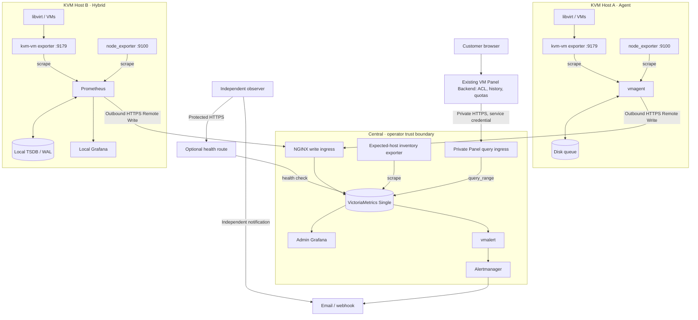

# Monitoring: architecture and guide

[繁體中文](monitoring.zh-TW.md)

Use `kvm-vm monitor` for live VM statistics, `kvm-vm exporter` for Prometheus-compatible sampling, and the optional Docker tools for historical monitoring. No agent inside a VM is required. Central monitoring uses outbound Remote Write so KVM hosts may be in separate sites or behind NAT. The current Central backend is VictoriaMetrics Single; it is not a tenant-isolated database or an HA deployment.

## Architecture

Arrows describe data or requests, not TCP connection direction for scrapes. Exporters, local Prometheus/Grafana and the Central TSDB/Grafana bind to loopback in the stock deployment; Central inventory and alert components are Docker-internal. NGINX listeners and the external Panel and observer are **optional operator-configured integrations**, not services installed automatically by Compose. Only the remote writer needs a WAN path to the write ingress. The observer must have an independently configured health route. See [Central deployment](central-monitoring.md) for configuration and network boundaries.

## Choose a mode

| | Local | Agent | Hybrid |
|---|---|---|---|
| Typical use | One host, local dashboard | Central-only history across sites | Local dashboard plus central history |
| VM exporter | Yes | Yes | Yes |
| Bundled node_exporter | No | Yes | Yes |
| Local Prometheus / Grafana | Yes | No | Yes |
| Remote writer | None | vmagent | Local Prometheus |
| Local historical query | 15d default | No (queue only) | 15d default |
| Offline upload buffer | N/A | 2 GiB per URL default, disk queue | Prometheus WAL; limited recovery window |
| Central history | No | 30d default | 30d default |
| Start | `setup-monitoring.sh up` | `setup-monitoring.sh up --mode agent` | `setup-monitoring.sh up --mode hybrid` |

Commands above are under `tools/` and require root for deployment. Stop the old mode before switching; only one Remote Write writer is permitted. Queues/WAL do not transfer between writers. Standalone `monitor`/`exporter` and `identity` do not require Docker.

## Documentation map

| Goal | Authoritative guide |
|---|---|
| Live sampling and CLI options | [Command reference](commands.md#monitor) |
| Raw metric names, units, missing values, exporter setup | [Prometheus exporter](prometheus.md) |
| Local Docker stack | [Local monitoring](monitoring-stack.md) |
| Central and Host deployment, inventory, notifications, upgrades | [Central monitoring](central-monitoring.md) |
| Managed writer credentials, queues, diagnostics, observer and DR | [Security and reliability](monitoring-security-reliability.md) |
| Optional operator VM/tenant placement registry | [Ownership registry](monitoring-registry.md) |
| Discover host and VM UUIDs | [Identity CLI](integration/identity.md) |
| Integrate an existing multi-user Panel | [External Panel API contract](integration/monitoring-api.md) |
| Test evidence and rollout gates | [Monitoring acceptance](monitoring-acceptance.md) |
| Architecture decisions | [ADR 0006: direct/native tenant access](adr/0006-central-monitoring-tenant-security-boundary.md), [ADR 0007: external Panel](adr/0007-external-panel-monitoring.md) |

## Access and ownership boundaries

| Interface / data | Authorized caller | Not a guarantee of |
|---|---|---|
| Write ingress | Trusted host writer credential | VM ownership or authenticity of all metric labels |
| Expected-host inventory | Central operator | Writer authentication or VM ownership |
| Ownership registry | Central operator (optional) | Tenant routing, query authorization or actual VM migration |
| Raw TSDB / Grafana | Central operator | Customer isolation |
| Private query ingress | Trusted Panel service identity + source restriction | Per-customer PromQL isolation; the service credential can query shared data |
| Panel customer route | Panel-authenticated user, service ACL and historical grant | Native storage isolation |

Use the Panel database as the authority for customer/service ownership when integrating an existing Panel; do not require duplicate manual registry entries. Without a Panel, the registry remains useful as operator metadata. Neither path changes the `customer-readiness` check for direct Central customer access (`BLOCKED`, exit 2). Native tenancy backend evaluation (Cluster, Mimir or independent Single instances) is deferred until requirements justify it. The external Panel path has its own live acceptance gate, not a blanket authorization to launch.
