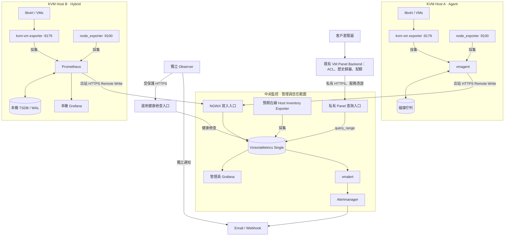

# 監控：架構與文件導覽

[English](monitoring.md)

`kvm-vm monitor` 提供即時資源統計，`kvm-vm exporter` 提供 Prometheus 相容指標，選用 Docker 工具保存歷史資料。VM 內不需安裝 Agent。中央監控採出站 Remote Write，可跨機房及 NAT。現行中央後端為 VictoriaMetrics Single，不具原生租戶儲存隔離，也不是高可用部署。

## 整體架構

箭頭表示資料流或請求，不代表 Scrape 的 TCP 發起方向。預設部署的 Exporter、本機 Prometheus/Grafana 與中央 TSDB/Grafana 都限制在 loopback；中央 Inventory、告警元件使用 Docker 內部網路。NGINX、外部 Panel 與 Observer 為管理員選用並另行配置的整合，Compose 不會自動啟用。跨機房 Host 只需對中央寫入入口出站；Observer 需另行配置健康檢查路徑。詳見[中央部署](central-monitoring.zh-TW.md)。

## 選擇部署模式

| 比較項目 | Local | Agent | Hybrid |
|---|---|---|---|
| 適用情境 | 單機本地圖表 | 多機房集中監控 | 本地圖表與中央歷史並存 |
| VM Exporter | 有 | 有 | 有 |
| 內建 node_exporter | 無 | 有 | 有 |
| 本機 Prometheus / Grafana | 有 | 無 | 有 |
| 遠端 Writer | 無 | vmagent | 本機 Prometheus |
| 本機歷史查詢 | 預設 15 天 | 無（只有佇列） | 預設 15 天 |
| 離線上傳緩衝 | 不適用 | 磁碟佇列，預設每 URL 2 GiB | WAL，補傳時間有限 |
| 中央歷史 | 無 | 預設 30 天 | 預設 30 天 |
| 啟動指令 | `setup-monitoring.sh up` | `setup-monitoring.sh up --mode agent` | `setup-monitoring.sh up --mode hybrid` |

上述部署指令位於 `tools/`，需 root 權限。切換模式先停止舊模式，同一 Host 只允許一個 Remote Write Writer。Queue 與 WAL 不會互相移轉。單獨執行 `monitor`、`exporter`、`identity` 不需要 Docker。

## 文件導覽

| 需求 | 權威文件 |
|---|---|
| 即時採樣與 CLI 參數 | [指令參考](commands.zh-TW.md#monitor) |
| 原始指標、單位、缺值語義及 Exporter | [Prometheus Exporter](prometheus.zh-TW.md) |
| 本機 Docker 部署 | [本機監控](monitoring-stack.zh-TW.md) |
| 中央與 Host 部署、Inventory、通知、升級 | [中央監控](central-monitoring.zh-TW.md) |
| Writer 憑證、Queue、診斷、Observer、DR | [安全與可靠性](monitoring-security-reliability.zh-TW.md) |
| 選用的管理員 VM/Tenant 歸屬資料 | [Ownership Registry](monitoring-registry.zh-TW.md) |
| 取得 Host 與 VM UUID | [Identity CLI](integration/identity.zh-TW.md) |
| 整合既有多用戶控制台 | [External Panel API 契約](integration/monitoring-api.zh-TW.md) |
| 測試證據與上線門檻 | [監控驗收](monitoring-acceptance.zh-TW.md) |
| 架構決策 | [ADR 0006：直接客戶存取與原生租戶隔離](adr/0006-central-monitoring-tenant-security-boundary.zh-TW.md)、[ADR 0007：外部 Panel](adr/0007-external-panel-monitoring.zh-TW.md) |

## 權限與資料歸屬

| 介面／資料 | 合法使用者 | 不代表 |
|---|---|---|
| 寫入入口 | 受信任 Host Writer 憑證 | VM 所有權、所有 metric labels 均可信 |
| Expected-host Inventory | 中央管理員 | 寫入認證或 VM 歸屬 |
| Ownership Registry | 中央管理員（選用） | 租戶路由、查詢授權或實際 VM 遷移 |
| 原始 TSDB／Grafana | 中央管理員 | 客戶隔離 |
| 私有查詢入口 | 受信任 Panel 服務身分與來源限制 | 依客戶限制 PromQL；服務憑證可查詢共享資料 |
| Panel 客戶 API | Panel 已驗證使用者、服務 ACL 與歷史授權 | 原生儲存隔離 |

搭配既有 Panel 時，以 Panel 資料庫作為客戶及服務歸屬的權威來源，不要求重複維護 Registry。沒有 Panel 時，Registry 仍可作為管理員 metadata。兩者都不改變中央直接客戶登入的 `customer-readiness`（BLOCKED，exit 2）。Cluster、Mimir 或每租戶獨立 Single 的選型延後至確有需求；Panel 功能須通過獨立實機驗收才能上線。
