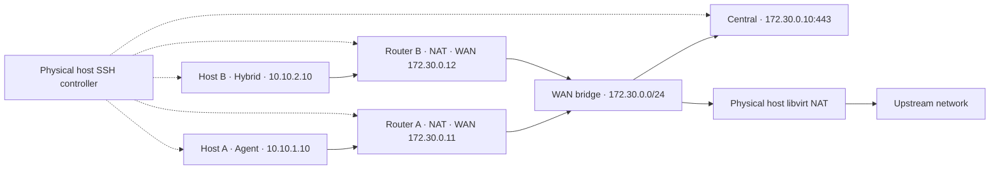

# Isolated Central Monitoring KVM/NAT Lab

[繁體中文](README.zh-TW.md)

This is a **destructive-to-lab-only, opt-in integration lab**. It uses a *single disposable Linux KVM hypervisor* to emulate two independently NATed sites and an Internet-facing central-monitoring server. The actual `kvm-vm` monitoring stack is installed inside the lab VMs; the Python offline tests do **not** substitute for a successful live run.

## Topology



- Three libvirt networks: `kvm-e2e-cm-wan` (**NAT**, `172.30.0.0/24`), `kvm-e2e-cm-site-a` and `kvm-e2e-cm-site-b` (**isolated**, `10.10.1.0/24` / `10.10.2.0/24`). No changes to libvirt's `default` network.
- Five disposable VMs: Central, two Linux NAT routers, two simulated nested KVM Hosts. The site routers NAT all outbound traffic; the outer libvirt WAN also NATs outbound to the physical host's upstream connection.
- Only the physical hypervisor has out-of-band access to all three bridges for SSH provisioning. Central's only NIC is in WAN; an additional **central-guest-only blackhole route** for each private LAN prevents the privileged physical hypervisor from accidentally providing site ingress. The live connectivity scenario must also prove it cannot connect to either private site's SSH directly. If that test fails, **treat the isolation as broken**, do not claim a valid NAT lab.
- Central is reachable at `172.30.0.10:443` with a **short-lived private lab CA** and separate per-Host Basic Auth identities. Neither Agent nor Hybrid disables TLS verification.

## Prerequisites

- **Disposable physical host**, Linux, `qemu:///system`, `/dev/kvm`; root privileges. Budget **at least 24 GiB host RAM**, ~80 GiB of free disk space, and enough CPU for five nested workloads. Guest settings total ~17.5 GiB RAM before any nested test VMs.
- Installed on physical host: `virsh`, `virt-install`, `qemu-img`, `cloud-localds`, `ssh`, `ssh-keygen`, `openssl`, `python3`, `iproute2`.
- A **trusted local, apt-based x86_64 Debian 13 or Ubuntu 24.04 cloud image** (`qcow2`, cloud-init and systemd included). The script does **not** silently download an unverified image. Package repos must be reachable from the virtual WAN (through the physical host's Internet connection).
- Guest provisioning requires `apt-get`, `docker.io`, a Docker Compose v2 apt package (`docker-compose-v2` or `docker-compose-plugin`), `nginx`, `iptables`, `libvirt` and appropriate CPU flags. Confirm guest images/repository package names in the environment to be tested.
- For **running nested same-name VMs**: expose nested virtualization to the first-level Host VMs (`/dev/kvm` inside Host A/B). If unavailable, that scenario **fails explicitly**; other Remote Write/network scenarios can still run.
- The lab uses fixed private subnets; it fails preflight when an existing physical route overlaps. **Do not run multiple instances on one physical host** with the same fixed subnets. Run on a machine without production workloads where possible.

## Commands

From repository root:

```bash
# Read-only preview: no root, libvirt or Docker required
./tests/e2e/lab.sh plan

# Full one-command creation + VM bootstrap (installs packages inside lab guests)
sudo ./tests/e2e/lab.sh up --image /path/to/debian13-cloud.qcow2

# If you need to troubleshoot the guest boot/provisioning separately:
sudo ./tests/e2e/lab.sh up --image /path/to/debian13-cloud.qcow2 --no-bootstrap
sudo ./tests/e2e/lab.sh bootstrap

sudo ./tests/e2e/lab.sh status
sudo ./tests/e2e/lab.sh test                 # fast smoke: connectivity, metrics, auth
sudo ./tests/e2e/lab.sh test all             # full suite, including ~10+ min offline alert
sudo ./tests/e2e/lab.sh test same-name-vms
sudo ./tests/e2e/lab.sh test disconnect-recover

# Manually impair only one disposable Router VM
sudo ./tests/e2e/lab.sh fault host-a disconnect
sudo ./tests/e2e/lab.sh heal host-a
sudo ./tests/e2e/lab.sh fault host-b netem --latency 150 --loss 3 --rate 1mbit
sudo ./tests/e2e/lab.sh heal host-b

# Stops and undefines only manifest-owned lab VMs/networks;
# keeps report, CA, credentials and deployment diagnostic state by default.
sudo ./tests/e2e/lab.sh down
sudo ./tests/e2e/lab.sh down --purge    # ONLY if lab is still initialized; delete state too
```

Use `sudo ./tests/e2e/lab.sh --lab-id cm ...` for the default Lab ID (`cm`). Paths and IDs are restricted, and `up` refuses to adopt preexisting libvirt domains or networks. Lab state is stored under `/var/lib/kvm-vm-e2e-lab/cm/` with root-only permissions, including test credentials and the CA private key. **Never commit or upload this state directory.** You can choose a dedicated volume via `KVM_VM_E2E_STATE_ROOT`.

**Important:** The VM disks are *copy-on-write overlays* over the supplied base cloud image. Do not delete or modify the image while the lab is running. `down` deletes lab-created overlays; it does not delete your base image or any Docker volumes outside the disposable VMs.

## Automated scenarios

| Scenario | What must be observed |
|---|---|
| `connectivity` | All five SSH endpoints reachable by controller; TLS validation succeeds; Central cannot directly SSH to site Hosts |
| `double-nat` | Each Host routes via its dedicated Router MASQUERADE, then through libvirt WAN NAT |
| `metrics` | Both Host UUIDs appear at Central for `kvm_vm_collector_success` and `node_memory_MemAvailable_bytes` |
| `same-name-vms` | Each nested KVM Host runs a QEMU VM named `e2e-web01`; Central sees two separate `host_id` series |
| `latency-loss` | 150 ms delay, 1% loss, 1 Mbit/s on Router WAN; recent metrics still arrive; `tc` rule is removed |
| `disconnect-recover` | Router blocks Remote Write; vmagent's disk queue grows; vmagent is restarted; historical samples from outage are replayed after restoration |
| `auth` | Unauthenticated and incorrect Basic Auth `POST` rejected with HTTP 401 |
| `host-offline` | Inventory-based `KvmVmHostOffline` fires after sustained disconnection (up to 13 min wait), then resolves |
| `mode-switch` | Host B switches Hybrid → Agent → Hybrid without changing `host_id`; final metrics still arrive |

Each `test` produces a dated JSON **PASS/FAIL** report under `.../reports/`. Failures are reported with nonzero exit; do not treat partial passes as complete success. `disconnect-recover`, `latency-loss` and `host-offline` use `finally` blocks to heal their simulated router fault. If interrupted with SIGKILL or power loss, manually run `heal`.

## Known limitations / next work

1. **Historical evidence is version-specific.** See [Monitoring acceptance](../../docs/monitoring-acceptance.md). Offline tests prove scripts/settings, not a new live run. Record actual logs for the commit under test.
2. Router connectivity depends on guest cloud-init NIC matching and distro packages. If the cloud image uses different network tooling or Docker Compose apt package names, fix the Lab installer for that distro with a test before declaring support.
3. WAN NAT and traffic shaping simulate many network failures but do not reproduce real ISP routing, independent power failures, DNS propagation or external CA lifecycle. Real cross-site validation is still needed before production.
4. The lab CA lasts seven days. Credentials and private keys live only in local lab state; managed writer rotation/revocation has a dedicated drill below.
5. This first lab automates ingress authentication, metrics, queue replay, offline alerts and mode switching. The base suite does not cover full notification delivery, queue overflow, guest workload or production DR. Separate drills cover a synthetic independent receiver and blank-guest restore; do not imply that they are already covered.
6. The test VM `e2e-web01` is a **real running QEMU domain with no boot disk**. It is sufficient to test the libvirt domain identity/metrics path, but **not** the behavior of a fully booted guest OS; add a cloud-image-backed nested domain for resource/workload tests.
7. Faults are applied inside disposable routers, never to physical host iptables/nftables. `down` is scoped by an on-disk ownership manifest and should be tested on a disposable physical host before using near customer VMs.

## Offline checks (safe on any development machine)

```bash
python3 -m pytest tests/test_monitoring_e2e_lab.py -q
bash -n tests/e2e/lab.sh
python3 -m py_compile tests/e2e/lab.py tests/e2e/inject_lab_ca.py
```

## Extended drills

After a clean bootstrap, run the base suite and these opt-in drills one at a time on the same owned Lab ID (`harden` below is an example, use the actual ID). The writer-recovery, host-level tenant handoff and cold restore protocols are in the [historical hardening guide](../../docs/plans/20261118_central-hardening/README.md). The restore target must be an extra blank guest.

```sh
sudo python3 tests/e2e/writer_recovery.py --lab-id harden
sudo python3 tests/e2e/tenant_handoff.py --lab-id harden
sudo python3 tests/e2e/recovery_drill.py --lab-id harden
```

Use a valid lab CA and no production credentials:

```sh
sudo python3 tests/e2e/managed_writer_drill.py --lab-id harden
sudo python3 tests/e2e/resilience_drill.py --lab-id harden --host host-a --seconds 3600
sudo python3 tests/e2e/resilience_drill.py --lab-id harden --host host-a --seconds 86400 --kill-writer --allow-loss
sudo python3 tests/e2e/resilience_drill.py --lab-id harden --host host-a --seconds 259200 --allow-loss
sudo python3 tests/e2e/resilience_drill.py --lab-id harden --host host-b --seconds 86400 --allow-loss
```

The long-outage drill blocks only the selected lab router's WAN-to-Central write path; it reads local diagnostics, optionally kills the selected writer, heals on exit, verifies fresh upload and exports **original** successful collector sample timestamps from the interrupted window. The default maximum sample gap is 45 seconds (15s scrape); `--allow-loss` reports LOSS_OR_DELAY_OBSERVED rather than asserting PASS. SIGKILL or machine loss of the controller requires manual `lab.sh heal` as documented in the Lab guide. Do not infer all series were recovered from one heartbeat series. Save sanitized reports and compare full representative VM/host counter coverage separately.

Additional manual acceptance until automated: deliberately drive a disposable Agent queue to its 512 MiB minimum or configured cap using synthetic load and separate disk limits; measure actual used bytes, queue drop counters, gaps, free disk and recovery. Inject 429/503/401/403 only on a test ingress; verify response-specific retries/loss and actual sample coverage. Repeat mode-switch, SIGKILL, TLS revocation/rotation and alert notification, external observer and offsite backup restore. Test label-limit and malformed-payload edge cases before using the binding as a security boundary. Record PASS/FAIL/NOT RUN, version, duration, raw evidence and RPO/RTO; do not mark these live checks complete from offline tests.
