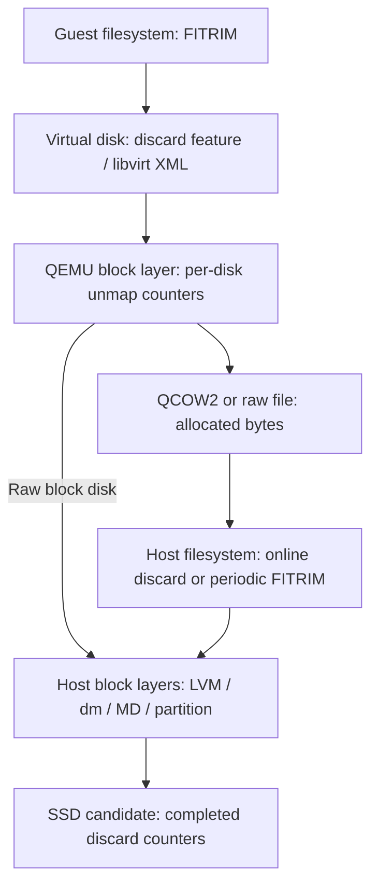

# KVM Host Check

English | [繁體中文](README.zh-TW.md)

A standalone Python 3 tool for auditing local Linux QEMU/KVM hosts managed by libvirt and diagnosing whether guest discard (TRIM/UNMAP) is observed at the host storage and SSD layers. It distinguishes configuration capability from runtime evidence, rather than treating a successful guest `fstrim` as proof of SSD discard.

**Version:** 1.0.0. The default audit does not initiate TRIM or change VM/storage configuration. QMP queries are enabled by default for active domains; use `--no-qmp` for a conservative static-only audit (see Safety).

## Features

- Inventory all defined VMs, or report selected domains by name/UUID and optionally a disk target.
- Inspect local QCOW2 and raw file/block disks, libvirt XML discard settings, backing-chain indicators and live/persistent configuration differences.
- Resolve local filesystem and Linux block-device dependencies, including partitions, device mapper, LVM thin pools and Linux MD RAID; report discard capabilities, device models and cumulative counters.
- Inspect mount discard options, systemd `fstrim.timer` and service status where available, and shared storage endpoints.
- Read QEMU QMP per-disk unmap counters and, where available, the VirtIO-BLK QOM discard property. Parent-node statistics are reported separately, not summed.
- Compare snapshots of file allocation, QMP statistics and block discard counters during passive observation or opt-in Guest/Host FITRIM.
- Report host CPU and memory inventory; support JSON output, strict exit status and optional nominal memory headroom policy.

## Requirements and installation

Run on the Linux **host**, not inside a guest. Intended for local libvirt QEMU/KVM environments, such as Debian/Ubuntu or AlmaLinux/Rocky Linux. No third-party Python modules or pip installation are needed. Python 3.8+ is a practical baseline; the offline tests do not establish compatibility with every distribution or Python version.

| Component | Requirement |
| --- | --- |
| Python 3 | Required |
| `virsh` (libvirt client) | Required; access to the local QEMU connection |
| `findmnt` (util-linux) | Required |
| `fstrim` (util-linux) | Required only for `--host-trim` |
| `lvs` (lvm2) | Optional; recommended for LVM hosts |
| `systemctl` | Optional; timer/service inspection on systemd hosts |
| QEMU Guest Agent | Guest-side requirement only for `--guest-trim` |

Debian / Ubuntu:

```sh
sudo apt install python3 libvirt-clients util-linux
# On LVM hosts:
sudo apt install lvm2
```

AlmaLinux / Rocky Linux:

```sh
sudo dnf install python3 libvirt-client util-linux
# On LVM hosts:
sudo dnf install lvm2
```

From the repository directory:

```sh
chmod +x host-trim-check.py
./host-trim-check.py --version
./host-trim-check.py --help
```

Use an account with sufficient libvirt and storage inspection privileges. The examples use `sudo` for the system libvirt connection; Host FITRIM explicitly requires root. For `qemu:///session`, run as the owner of the session rather than using `sudo` indiscriminately.

## Quick start

### 1. Audit all VMs (recommended for routine checks)

```sh
sudo ./host-trim-check.py --no-qmp
```

This is a static inspection of defined domains, including stopped domains. Omit `--no-qmp` to include available runtime QMP/QOM queries for active domains.

### 2. Inspect selected VMs or one disk

```sh
sudo ./host-trim-check.py vm01 vm02
sudo ./host-trim-check.py vm01 --disk vda
```

Domain UUIDs are also accepted. The tool still inventories the other domains for resource totals and shared-storage mapping.

### 3. Observe guest TRIM without a Guest Agent

On the host:

```sh
sudo ./host-trim-check.py vm01 --disk vda --watch 60
```

After the host reports that observation has started, run inside the Linux guest:

```sh
sudo fstrim -av
```

The script captures before/after snapshots over the observation window; it does not continuously trace each request. The `--watch` option alone does not initiate FITRIM.

### 4. Trigger guest FITRIM using QEMU Guest Agent

```sh
sudo ./host-trim-check.py vm01 --guest-trim
sudo ./host-trim-check.py vm01 --disk vda --guest-trim --mountpoint / --settle 10
```

This uses `virsh domfstrim`. The VM must be running with a working guest agent that supports the operation. `--disk` filters the observations only, not the guest agent's FITRIM scope. Use `--mountpoint` to request a specific guest filesystem.

### 5. Separate guest discard from Host FITRIM

```sh
sudo ./host-trim-check.py vm01 --guest-trim --host-trim --settle 10
# Without a Guest Agent (run fstrim in the guest during the watch window):
sudo ./host-trim-check.py vm01 --watch 60 --host-trim
```

The first phase measures guest activity; the second explicitly trims eligible host filesystems and measures each separately. The host operation trims the **entire selected filesystem**, not just VM-owned free space. It is not applicable to raw block disks without a host filesystem. Use a maintenance or low-traffic window.

### 6. Automation and JSON

```sh
sudo ./host-trim-check.py --no-qmp --strict --json > report.json
sudo ./host-trim-check.py --no-qmp --min-host-memory-gib 6
```

JSON output uses `schema_version: 1`; progress is sent to stderr. Inspect `summary`, `exit_code`, `vms`, `host`, and `phases`. JSON includes domain names, disk paths, host details and storage topology; treat reports as potentially sensitive. A CLI/dependency error or interrupted execution may not produce a JSON report.

## Command-line reference

| Argument | Description |
| --- | --- |
| `[VM ...]` | Domain names/UUIDs; omit to audit all defined domains |
| `--uri URI` | `qemu:///system` (default) or `qemu:///session`; local connections only |
| `--disk TARGET` | Filter one disk target, e.g. `vda`; exactly one explicit VM required |
| `--watch SECONDS` | Positive observation duration; one running VM required |
| `--guest-trim` | Request guest FITRIM via QEMU Guest Agent; one running VM required |
| `--mountpoint PATH` | Absolute guest mountpoint; requires `--guest-trim` |
| `--host-trim` | After guest observation, explicitly FITRIM eligible host filesystems; requires `--watch` or `--guest-trim` and root |
| `--settle SECONDS` | Wait after active trim (default: 5; nonnegative) |
| `--timeout SECONDS` | Timeout for each trim command (default: 300; positive) |
| `--no-qmp` | Skip QMP/QOM in static audit; incompatible with runtime observation |
| `--json` | Emit a structured JSON report |
| `--strict` | Return 3 for WARN/UNKNOWN unless FAIL or execution error takes precedence |
| `--min-host-memory-gib N` | Optional nonnegative nominal memory headroom policy; no default threshold |
| `--version`, `--help` | Print version or help |

If `--watch` and `--guest-trim` are both supplied, the watch duration is used after the guest command returns. Static audit has no required minimum free host memory threshold.

## How TRIM is verified



The tool reads Linux block `stat` fields 12 and 14 (one-based): completed discard operations and discarded sectors (512 bytes per sector). It measures file allocation with `st_blocks * 512`, not the image's apparent size. QEMU statistics are measured separately at the front-end and parent nodes.

Host filesystem online discard and periodic FITRIM are both valid policies. With periodic trim, guest TRIM can reclaim QCOW2 allocation before any SSD discard is observed. LVM thin-pool `passdown`, `nopassdown`, and `ignore` are distinguished; pool capacity risk is a separate concern. Machine type alone does not establish VirtIO discard support.

## Interpreting results

| Status | Meaning |
| --- | --- |
| `OK` | Static capability/configuration check passed; not proof of runtime forwarding |
| `OBSERVED` | Positive runtime evidence was seen |
| `WARN` | Potential risk or an incomplete confidence condition |
| `FAIL` | Explicit configuration blocker or operation failure |
| `UNKNOWN` | Missing, ambiguous, reset or unsupported evidence |
| `SKIPPED` | Not applicable or intentionally not executed |

Common runtime messages:

| Message | Interpretation |
| --- | --- |
| `CORRELATED` | Per-disk QEMU unmap or image reclamation and SSD discard increased in the same interval; attribution is not proven |
| `QEMU_UNMAP_OBSERVED` | QEMU unmap increased but SSD discard was not observed |
| `IMAGE_RECLAIM_OBSERVED` | File allocation shrank; the source is not proven |
| `SSD_DISCARD_OBSERVED` | SSD candidate counters increased; originating VM is unknown |
| `HOST_DISCARD_OBSERVED` | Host FITRIM phase observed device-wide discard, not VM-specific |
| `INCONCLUSIVE` | No positive correlated evidence; not necessarily a failure |

For example, QEMU unmap and file reclamation without immediate SSD discard, followed by SSD discard in the Host FITRIM phase, is consistent with periodic host TRIM. It does not prove that the SSD operations correspond exactly to that VM's previously freed extents.

### Exit codes

| Code | Meaning |
| --- | --- |
| 0 | No explicit FAIL or execution error; WARN/UNKNOWN may exist without `--strict` |
| 1 | One or more FAIL findings |
| 2 | CLI, dependency, execution or operation error |
| 3 | Strict mode with WARN or UNKNOWN, without higher-priority failure |
| 130 | Interrupted by the user |

**Exit 0 does not certify end-to-end TRIM.** In particular, a static audit does not exercise the data path.

## Safety and limitations

- The default audit does not write test data, change configuration or initiate trim. Read-only QMP commands through libvirt may still leave a `custom-monitor` taint record on some versions. Use `--no-qmp` for routine static audits if this matters; runtime modes require QMP.
- `--guest-trim` and `--host-trim` are opt-in active operations. FITRIM can increase storage latency; avoid repeated testing on a busy production host. A timeout does not guarantee the underlying operation has stopped.
- Device-wide SSD statistics include other VMs and host activity. Use a quiet observation window; simultaneous activity, already trimmed ranges and counter resets can affect results. No discard request tracing or NAND-level verification is performed.
- Concurrent writes, snapshots, backing chains, `discard_no_unref`, shared extents and image changes can mask allocation reclamation. A zero or negative allocation delta is not proof of failure.
- Supported local file filesystems are ext3/ext4, XFS and F2FS. Btrfs, ZFS, Ceph, NFS, external QCOW2 data files, loop/remote storage and complex or hidden hardware topologies are not fully resolved. Nonrotational endpoints are SSD candidates, not guaranteed physical devices.
- Older QEMU/kernel builds or insufficient permissions can make counters unavailable. QMP disk mapping and process continuity are best effort; the tool reports uncertainty instead of substituting zero for unavailable data. RAID/DM graphs may include metadata branches.
- `fstrim.timer` being active is not proof of a successful run or mount inclusion. Manual or alternative scheduled trim may exist. The tool does not auto-enable discard or change LVM/RAID policies.
- CPU/memory totals are inventory estimates, not utilization or performance measurements. No real KVM + SSD end-to-end validation has been completed for this version.

## Development and testing

```sh
python3 -m py_compile host-trim-check.py test-host-trim-check.py
python3 test-host-trim-check.py
```

The 14 offline unit tests use fixtures/mocks; they do not issue real VM, QMP or FITRIM commands. Validate on a noncritical KVM host before relying on runtime diagnostics in production.

```text
host-trim-check/
├── host-trim-check.py       # Standalone CLI
├── test-host-trim-check.py  # Offline unit tests
├── README.md              # English documentation
├── README.zh-TW.md        # Traditional Chinese documentation
└── .gitignore
```

## License

No license has been selected. Do not infer an open-source license from the presence of a Git repository.
