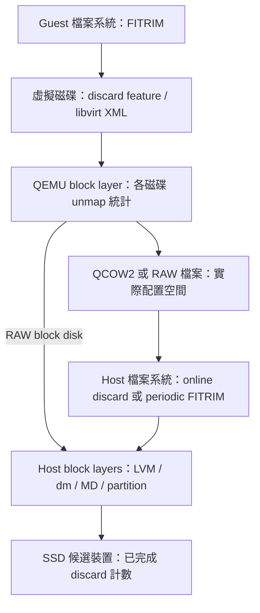

# KVM Host Check

[English](README.md) | 繁體中文

獨立的 Python 3 工具，用於 Linux QEMU/KVM + libvirt Host 的設定巡檢，以及診斷 Guest 發出的 discard（TRIM/UNMAP）是否能在 Host 儲存層及 SSD 觀察到。工具區分「具備傳遞條件」與「實際觀測證據」，不將 Guest `fstrim` 成功直接視為 SSD 已收到 TRIM。

**版本：**1.0.0。預設巡檢不會主動執行 TRIM，也不修改 VM 或儲存設定。執行中的 VM 預設包含 QMP 查詢；若要進行保守的靜態巡檢，請使用 `--no-qmp`（詳見安全性與限制）。

## 功能

- 巡檢全部已定義的 VM，或依名稱、UUID 指定 VM，以及指定單顆磁碟。
- 檢查本機 QCOW2、RAW 檔案與區塊裝置，包含 libvirt XML 的 discard 設定、backing chain 指標及 Live/Persistent 設定差異。
- 追蹤 Host 檔案系統與 Linux block device 依賴關係，包括 partition、Device Mapper、LVM thin pool、Linux MD RAID；顯示 discard 能力、裝置型號及累積統計。
- 檢查 mount discard 選項、systemd `fstrim.timer` 與 service 狀態（若可取得），並盤點共用底層儲存裝置的 VM。
- 取得 QEMU QMP 每顆磁碟的 unmap 統計，以及可取得的 VirtIO-BLK QOM discard property；各 parent node 的計數獨立顯示，不重複加總。
- 支援被動觀測及選用 Guest/Host FITRIM，分階段比較檔案配置空間、QMP 統計與 block discard 計數。
- 提供 Host CPU／記憶體盤點、JSON 輸出、Strict Mode 與選用的名目記憶體保留量政策。

## 系統需求與安裝

在 Linux **Host** 上執行，不是在 Guest VM 內執行。適用於本機 libvirt QEMU/KVM 環境，例如 Debian/Ubuntu 或 AlmaLinux/Rocky Linux。不需要第三方 Python 模組或 pip 安裝。建議以 Python 3.8 以上為基準；離線測試不代表已驗證所有發行版及 Python 版本。

| 相依項目 | 需求 |
| --- | --- |
| Python 3 | 必要 |
| `virsh`（libvirt client） | 必要，需能存取本機 QEMU connection |
| `findmnt`（util-linux） | 必要 |
| `fstrim`（util-linux） | 僅 `--host-trim` 需要 |
| `lvs`（lvm2） | 選用；LVM Host 建議安裝 |
| `systemctl` | 選用；systemd Host 用於檢查 timer/service |
| QEMU Guest Agent | 僅 `--guest-trim` 需要在 Guest 安裝及啟用 |

Debian / Ubuntu：

```sh
sudo apt install python3 libvirt-clients util-linux
# 有使用 LVM 時：
sudo apt install lvm2
```

AlmaLinux / Rocky Linux：

```sh
sudo dnf install python3 libvirt-client util-linux
# 有使用 LVM 時：
sudo dnf install lvm2
```

在 repo 目錄下執行：

```sh
chmod +x host-trim-check.py
./host-trim-check.py --version
./host-trim-check.py --help
```

執行帳號需具備足夠的 libvirt 與儲存檢查權限。以下範例使用 `sudo` 存取 system libvirt connection；Host FITRIM 明確要求 root。若使用 `qemu:///session`，請以該 session 的擁有者身分執行，不宜直接套用所有 `sudo` 範例。

## 快速開始

### 1. 全 Host 巡檢（建議日常使用）

```sh
sudo ./host-trim-check.py --no-qmp
```

靜態檢查所有已定義的 VM，包括已關機的 VM。移除 `--no-qmp` 可對執行中的 VM 加入可取得的 QMP/QOM 查詢。

### 2. 指定 VM 或磁碟

```sh
sudo ./host-trim-check.py vm01 vm02
sudo ./host-trim-check.py vm01 --disk vda
```

也支援 Domain UUID。即使指定 VM，工具仍會盤點其他 VM，以計算 Host 資源及共用儲存裝置關係。

### 3. 被動觀測 Guest TRIM（不需 Guest Agent）

先在 Host 執行：

```sh
sudo ./host-trim-check.py vm01 --disk vda --watch 60
```

等 Host 顯示開始觀測後，在 Linux Guest 內執行：

```sh
sudo fstrim -av
```

工具比較觀測區間前後的快照，不會持續追蹤每一筆 discard request。單獨使用 `--watch` 不會主動發出 FITRIM。

### 4. 透過 QEMU Guest Agent 主動執行 Guest FITRIM

```sh
sudo ./host-trim-check.py vm01 --guest-trim
sudo ./host-trim-check.py vm01 --disk vda --guest-trim --mountpoint / --settle 10
```

此模式使用 `virsh domfstrim`，VM 必須處於 running 狀態，且 Guest Agent 正常運作並支援此操作。`--disk` 僅限制觀測對象，不限制 Guest Agent 的 FITRIM 操作範圍。若要指定 Guest 檔案系統，使用 `--mountpoint`。

### 5. 分階段測試 Guest TRIM 與 Host FITRIM

```sh
sudo ./host-trim-check.py vm01 --guest-trim --host-trim --settle 10
# 沒有 Guest Agent 時，在 watch 期間手動於 Guest 執行 fstrim：
sudo ./host-trim-check.py vm01 --watch 60 --host-trim
```

第一階段觀測 Guest 的行為，第二階段主動對符合條件的 Host 檔案系統執行 FITRIM，並分別測量各檔案系統的結果。Host FITRIM 會處理**整個選定的 Host 檔案系統**，不僅限該 VM 釋放的空間。沒有 Host 檔案系統的 RAW block disk 不適用此操作。建議於維護時段或低負載時執行。

### 6. 自動化與 JSON 輸出

```sh
sudo ./host-trim-check.py --no-qmp --strict --json > report.json
sudo ./host-trim-check.py --no-qmp --min-host-memory-gib 6
```

JSON 報告使用 `schema_version: 1`，進度訊息輸出至 stderr。可使用 `summary`、`exit_code`、`vms`、`host`、`phases` 等欄位整合自動化。報告包含 VM 名稱、磁碟路徑、Host 資訊與儲存拓撲，應視為可能含機密資訊的資料。參數／相依套件錯誤或中斷時，不一定會產生 JSON 報告。

## CLI 參數

| 參數 | 說明 |
| --- | --- |
| `[VM ...]` | Domain 名稱或 UUID；省略時巡檢全部已定義 VM |
| `--uri URI` | `qemu:///system`（預設）或 `qemu:///session`；僅支援本機連線 |
| `--disk TARGET` | 指定磁碟，例如 `vda`；必須明確指定一台 VM |
| `--watch SECONDS` | 正整數秒數的觀測時間；需指定一台 running VM |
| `--guest-trim` | 透過 Guest Agent 執行 Guest FITRIM；需指定一台 running VM |
| `--mountpoint PATH` | Guest 的絕對 mountpoint；需搭配 `--guest-trim` |
| `--host-trim` | Guest 觀測後主動執行符合條件的 Host FITRIM；需搭配 `--watch` 或 `--guest-trim`，且需 root |
| `--settle SECONDS` | 主動 TRIM 後等待秒數（預設 5，可為 0） |
| `--timeout SECONDS` | 每個 TRIM 指令的逾時秒數（預設 300，須大於 0） |
| `--no-qmp` | 靜態巡檢時略過 QMP/QOM，不可搭配動態觀測模式 |
| `--json` | 輸出結構化 JSON 報告 |
| `--strict` | 有 WARN/UNKNOWN 且無更高優先級錯誤時回傳 3 |
| `--min-host-memory-gib N` | 選用的名目 Host 記憶體保留量政策，非負數，沒有預設門檻 |
| `--version`、`--help` | 顯示版本或使用說明 |

若同時指定 `--watch` 與 `--guest-trim`，Guest 指令返回後使用 watch 的指定秒數進行觀測。靜態巡檢沒有強制的最低 Host 剩餘記憶體門檻。

## TRIM 驗證架構



工具讀取 Linux block `stat` 的第 12 與第 14 欄（從 1 開始計數），分別代表已完成的 discard 次數及 discarded sectors（每 sector 為 512 bytes）。檔案配置空間使用 `st_blocks * 512`，而不是檔案表面大小。QEMU front-end 與 parent nodes 的統計分開測量。

Host online discard 與 periodic FITRIM 都是有效策略。採定期 TRIM 時，Guest TRIM 可能先回收 QCOW2 配置空間，稍後才在 SSD 觀察到 discard。LVM thin pool 的 `passdown`、`nopassdown`、`ignore` 應分別判讀，容量耗盡是另一項風險。單憑 VM machine type 不能證明 VirtIO discard 支援狀態。

## 結果判讀

| 狀態 | 意義 |
| --- | --- |
| `OK` | 靜態能力或設定檢查通過，不代表實際傳遞成功 |
| `OBSERVED` | 觀察到正向的動態證據 |
| `WARN` | 潛在風險或可信度受限 |
| `FAIL` | 明確設定阻礙或操作失敗 |
| `UNKNOWN` | 證據缺少、歧義、重置或不支援 |
| `SKIPPED` | 不適用或刻意略過 |

常見動態觀測結果：

| 訊息 | 說明 |
| --- | --- |
| `CORRELATED` | 同一區間內 QEMU unmap 或檔案空間回收與 SSD discard 同時出現；尚不能確認因果關係 |
| `QEMU_UNMAP_OBSERVED` | QEMU unmap 增加，但未觀察到 SSD discard |
| `IMAGE_RECLAIM_OBSERVED` | 檔案配置空間減少，來源尚未證實 |
| `SSD_DISCARD_OBSERVED` | SSD 候選裝置的 discard 計數增加，但無法確認來自哪台 VM |
| `HOST_DISCARD_OBSERVED` | Host FITRIM 階段觀察到整個裝置的 discard，並非 VM 專屬 |
| `INCONCLUSIVE` | 沒有正向的相關證據，不一定代表 TRIM 失敗 |

例如 Guest 階段觀察到 QEMU unmap 與檔案配置空間減少，SSD discard 未增加；Host FITRIM 階段才出現 SSD discard，這與 periodic TRIM 的行為一致，但仍不能證明 SSD 操作完全對應該 VM 先前釋放的 extents。

### Exit Code

| Code | 意義 |
| --- | --- |
| 0 | 無明確 FAIL 或執行錯誤；未使用 `--strict` 時仍可能有 WARN/UNKNOWN |
| 1 | 存在 FAIL 項目 |
| 2 | 參數、相依套件、執行或操作錯誤 |
| 3 | Strict Mode 下存在 WARN 或 UNKNOWN，且無更高優先級的錯誤 |
| 130 | 使用者中斷 |

**Exit Code 0 不代表已證明端到端 TRIM。** 特別是靜態巡檢，並未實際測試資料傳遞路徑。

## 安全性與限制

- 預設巡檢不寫入測試資料、不修改設定、不主動 TRIM。透過 libvirt 執行唯讀 QMP 指令，在部分版本可能留下 `custom-monitor` taint 紀錄。如需避免，日常靜態巡檢請使用 `--no-qmp`；動態觀測模式則需要 QMP。
- `--guest-trim` 與 `--host-trim` 是明確指定才執行的主動操作。FITRIM 可能增加儲存延遲，避免在正式營運 Host 高負載時頻繁測試。指令逾時不保證底層操作已停止。
- SSD 統計是整個裝置共用，包含其他 VM 與 Host 的活動。建議選擇安靜的觀測時段；並行活動、已 TRIM 的區域及計數重置都會影響結果。本工具不追蹤個別 discard request，也不驗證 SSD 內部 NAND 回收。
- 並行寫入、snapshot、backing chain、`discard_no_unref`、共用 extents 及映像切換可能掩蓋檔案配置空間回收。淨回收量為零或負數不代表失敗。
- 本機檔案支援 ext3/ext4、XFS 與 F2FS。Btrfs、ZFS、Ceph、NFS、QCOW2 external data file、loop/遠端儲存與複雜或隱藏的硬體拓撲尚未完整解析。非旋轉裝置僅視為 SSD 候選，並不保證是真正實體 SSD。
- 舊 QEMU/kernel 或權限不足可能導致計數無法取得。QMP 磁碟對應與 process continuity 為盡力檢查；證據不足時不以 0 取代未知值。RAID/DM graph 可能包含 metadata branches。
- `fstrim.timer` 已啟用不代表最近執行成功或已包含該 mountpoint，也可能有手動或其他排程。本工具不自動啟用 discard、不更改 LVM/RAID 政策。
- CPU／記憶體盤點是估計配置量，不是實際利用率或效能測量。此版本尚未完成真實 KVM + SSD 的 E2E 驗收。

## 開發與測試

```sh
python3 -m py_compile host-trim-check.py test-host-trim-check.py
python3 test-host-trim-check.py
```

14 項離線單元測試使用 fixtures/mocks，不執行真實 VM、QMP 或 FITRIM 指令。正式營運使用動態診斷前，建議先在非關鍵 KVM Host 驗證。

```text
host-trim-check/
├── host-trim-check.py       # 獨立 CLI 主程式
├── test-host-trim-check.py  # 離線單元測試
├── README.md              # 英文文件
├── README.zh-TW.md        # 繁體中文文件
└── .gitignore
```

## 授權

目前尚未指定授權條款。Git repository 的存在不代表已採用開源授權。
